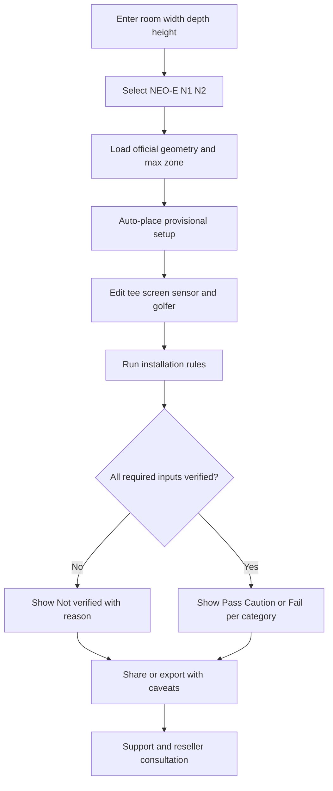

# NVISAGE 3D Installation & Swing Clearance Planner
## 공식 홈페이지 고객용 인터랙티브 3D 설계 도구 — Master Plan / Product Blueprint / Engineering Handoff

> **문서 버전:** 1.0 | **작성 기준:** 2026-10-08 KST  
> **용도:** Claude Code 개발 착수·병렬 작업·QA·공식 홈페이지 배포를 위한 단일 실행 명세서  
> **서비스 언어:** EN 우선, KO 확장 | **대상 제품:** NEO-E / N1 / N2  
> **현 상태:** 기획·소스 대조·3개 제품의 CAD→GLB 기술 시제품 검증 완료. **고객 서비스 구현·공식 배포·안전성 승인 미완료.**  
> **중요:** 이 문서가 기술팀의 설치 인증이나 고객의 안전을 보증하지 않음. 배포 전 `RELEASE_GATES` 승인 필수.

---

# 0. Executive Decisions — 먼저 읽을 것

## 0.1 제품 정의

**고객이 실내 골프 공간의 실측값을 입력하고 NEO-E, N1, N2를 선택하면 실제 CAD 형상 기반 제품, 최대 타격 영역, 설정 가능한 Ready/Tee Zone, 골퍼·골프채·스윙 공간, 스크린·매트·프로젝터·장애물을 하나의 3D 장면에서 이해하도록 돕는 NVISAGE 공식 설치 계획 도구.**

제품명(제안): **NVISAGE 3D Installation Planner**. 부제: **Design your space. Understand your setup.**

반드시 3가지를 동시에 달성한다.

1. **기구 정확도:** 현행 제품 외형을 실제 STEP CAD에서 생성하고 배치 치수·방향을 명확히 검증.
2. **사용성·고급 시각 경험:** 최상급 제품 쇼룸 수준의 PBR·조명·모션·브랜드 UI. 그러나 장면보다 설치 정보가 우선.
3. **정직한 판정:** 공식 자료로 확인된 값과 추정 스윙 경로, 고객이 지정한 설정을 혼동하지 않으며 미확인 조건은 절대 `Compatible`로 단정하지 않음.

## 0.2 이행 결론

- **실제 제품 3D CAD는 확보되었다.** 사용자가 `G4F-1300G-M214.stp`가 **N1**임을 명시적으로 확인했으며, N2와 NEO-E도 파일명·형상·외형 크기가 해당 제품과 일치한다.
- 3개 파일의 GLB **형상 검토용 초안**이 존재한다. 웹 로딩 확인과 외관 완성도는 다른 단계이다.
- **N1 16×20in, N2 31.5×23.6in, NEO-E 12.6×9.4in**는 공식 매뉴얼의 Hitting / Impact / Strike Zone 수치다. **Ready Zone의 현재 고객별 설정값과 동일하다고 간주하면 안 된다.**
- GSV 레퍼런스의 장점은 룸·키·좌/우타·장비·장애물·스윙 추정·공유를 **한 경험**으로 연결하는 점이다. 우리는 **NVISAGE 센서 고유 규격·실제 제품 CAD·매뉴얼 출처·지원 연결**로 차별화한다.
- 모든 고객 화면은 **공식 사이트의 브랜드 일관성**, **설치 설명력**, **성능**, **접근성**을 통과해야 한다. CSS 카드 몇 개와 형식적인 기하 도형만으로 공개하지 않는다.
- 미확인 규격·에셋 라이선스·기구팀 승인 없이 최종 배포 금지. 개발 중에는 근거 있는 값만 활성화하고 미검증 값은 `Not verified`로 표시한다.

## 0.3 데이터 사실성 표기 규칙

| 표기 | 의미 | 개발/배포 정책 |
|---|---|---|
| `[OFFICIAL]` | NVISAGE 공식 매뉴얼·공식 자산·기구 CAD에서 확인 | 근거 페이지, 버전, 검토일 필수 |
| `[USER-CONFIRMED]` | 이 프로젝트 진행자가 직접 확인 | 확인자·일자 기록 |
| `[MEASURED]` | 로컬 STEP/GLB를 프로그램으로 측정 | 처리법·원본 SHA256과 함께 기록 |
| `[REFERENCE]` | GSV, 경쟁사, 오픈소스 문서 등의 공개 자료 | NVISAGE 규칙으로 자동 승격 금지 |
| `[PROPOSED]` | 우리가 제안하는 UX·수치 목표·구조 | 구현 전 결정 기록 및 QA 필요 |
| `[OPEN]` | 아직 증빙이 부족함 | 데이터 값을 만들지 말 것; UI는 `Not verified` |

---

# 1. 목표, 범위, 성공 기준

## 1.1 우선순위

- **P0 고객 핵심:** 룸 W/D/H·단위 변경, 센서 전환, 실제 센서 GLB, 치수선, 매트/스크린, 최대 타격 영역, 좌표 정확성, 3D/Top/Side/Front, 판정 근거와 경고, 반응형 UI.
- **P0 제품 신뢰:** 공신력 있는 규격을 바탕으로 센서 위치/높이 검증, 설치 가이드 연결, CAD·소프트웨어 영역의 차이 노출, 영문 기본 카피, 외부 공개 가능 Asset만 제공.
- **P1 경험 차별화:** 골퍼 리깅 모델, 드라이버/아이언/퍼터 스윙 애니메이션, 좌우타, 추정 스윙 클리어런스와 충돌 표시, 장애물 드래그, 디자인 프리셋.
- **P1 상담 연동:** 유효한 공유 URL, PDF 설치 계획서, 상담/Support Ticket에 구성 스냅샷 첨부, 상태 저장/복원.
- **P2 확장:** 멀티 타석, 복합 천장, 곡면/비정형 룸, 실내 조명·투사 최적화, Installer Pro mode, 견적 및 파트너 연계.

**P0/P1을 통합한 공개 버전의 품질은 최상급으로.** MVP라는 명목으로 조잡한 샘플 모델·외형과 무관한 표면·저품질 타이포를 홈페이지에 내보내면 안 된다.

## 1.2 고객과 JTBD

| 사용자 | 목표 | 최소 입력 | 결과 |
|---|---|---|---|
| 첫 구매 고객 | 내 방에 제품이 설치 가능한가? | W/D/H + 제품 + 좌/우타 | 배치 + 치수 + 위험·미확인 항목 |
| 기존 N1/N2 고객 | 센서/타석을 어디에 달아야 하나? | 제품 + 설치 높이 + 타석 기준점 | 공식 설치 규격 비교·영역 보기 |
| NEO-E 고객 | 바닥형 포터블 배치와 공 인식 영역 이해 | 제품 + 타구 위치 + 손잡이 방향 | 본체·Strike Zone + 설치 주변 공간 |
| 리셀러/Installer | 고객 설치 견적 전 검토 | 룸 상세 + 장애물 + 장비 | 공유 링크/PDF/가정 목록 |
| 기술지원 담당 | 이미 설치한 장비의 환경 파악 | 공유 URL 또는 배치 파일 | 타석 위치, 문제 조건, 누락 자료 |

## 1.3 측정 가능한 KPI / 출시 목표(운영 제안)

- 첫 고객이 도움말 없이 룸 3치수→제품 선택→3D 결과에 **90초 이내** 도달하는 사용자 테스트 목표.
- 기본 설정 수정 후 결과 갱신 **주관적 지연 없이**, 엔진 계산 일반 케이스 **100ms 이내**(개발 중 벤치 측정; 고급 스윙 충돌은 별도).
- 제품별 공식 숫자 **100% 출처 추적 가능**, 매뉴얼과 불일치 항목 **0개**.
- 접근 가능한 표준 브라우저에서 치수·판정·PDF를 **3D 미지원 폴백으로도 열람** 가능.
- 설치 확인 수치를 제조사 엔지니어링 승인 없이 임의 생성한 버그 **0건**.
- 목표 프레임: 보급형 데스크톱 50~60fps, 보급형 모바일 25~30fps(초기 **성능 예산**, 실기기 프로파일링으로 확정).
- Core Web Vitals / 접근성 / 브라우저 에러 / 장시간 안정성 정량 검수 후 공개.

---

# 2. 현재 확보 자산 전체 목록과 검증 기록

## 2.1 Drive 원본

공유 Asset 폴더:  
https://drive.google.com/drive/folders/1vPfaEvc1VgM3m4qiJRJrNYDuo_ywtt95

확인한 구조:

```text
NVISAGE Reseller Assets/
├── Brand Logos/
│   ├── NVISAGE Logo white,green.png
│   ├── nvisage-logo-transparent-1200w.png
│   └── favicon / smaller logo variants
├── N1 Marketing Assets/
│   ├── NVISAGE_Front.jpg / NVISAGE_Side.jpg / NVISAGE_Right_Side.jpg
│   ├── nvisage-with-mounting-bracket.png
│   ├── nvisage-front-angle.png (~31 MB)
│   ├── nvisage-front-top-angle.png (~45 MB)
│   ├── nvisage-n1-straight.png
│   ├── N1 Promo Video.mp4
│   └── N1 Marked Balls/
├── N2 Marketing Assets/
│   ├── N2 Showroom.png / N2-set.png / 07.N2-PB.png
│   └── 02.N2-F.jpg / 03.N2-B.jpg / 05.N2-D.jpg / 06.N2-PF.jpg / 06.N2-F.tif
├── NEO-E Marketing Assets/
│   ├── 02.NEO-E.jpg / 03.NEO-E.jpg / Neo-E-F.jpg / Neo-E-B.jpg
│   ├── 00.NEO-E-set1.jpg / 00.NEO-E-set2.jpg
│   ├── ImageToStl.com_01.Neo-E.png / ImageToStl.com_05.Neo-E.png
│   └── neo-e_pga.png
├── MURLIE, MURLIE-X Marketing Assets/
│   ├── Images/
│   └── Videos/
├── iPad&iPhone with MURLIE/
├── Spec Sheet.xlsx
└── NVisage Leaflet.pdf
```

**주의:** `ImageToStl.com_...png`은 PNG이며 STEP/STL 3D 파일이라고 간주하지 않는다. Drive의 이미지들은 사진/재질/색상 참고와 마케팅 UI용이다. 정확한 외형 기하학은 첨부 STEP 우선.

## 2.2 제공된 STEP → 웹용 GLB 초안

세 STEP 원본 모두 `/mnt/data`에 첨부되어 있으며 이번 세션에서 초기 변환 GLB가 생성됨. **Claude Code가 실행될 로컬 PC에 자동으로 있는 것은 아니므로 파일 복사 절차가 필요.**

| 제품 | 사용자 확인·분류 | STEP 원본 | GLB preview | 메시 크기 | 시각화 anchor |
|---|---|---|---|---|---|
| **N1** | `[USER-CONFIRMED]` G4F=N1 | `G4F-1300G-M214.stp` | `G4F-1300G-M214_PREVIEW.glb` | 1,584,244 B | ceiling upper center |
| **N2** | `[MEASURED]` | `N2-5000G-M100D04-30.stp` | `N2-5000G-M100D04-30_PREVIEW.glb` | 2,326,376 B | ceiling upper center |
| **NEO-E** | `[MEASURED]` 외형 부합 | `LM-ES-ASSY_no-inner_parts_20250220.stp` | `LM-ES-ASSY_no-inner_parts_20250220_PREVIEW.glb` | 1,185,628 B | floor/base center |

모두 GLB `Y-up`, 길이 단위 `meter`. 초기 메시 1개로 합쳐진 무채색 형상 프리뷰이므로 원본 부품 분리, 정확한 컬러/로고/렌즈 및 장착 브라켓 구성은 미완성.

| 항목 | N1 | N2 | NEO-E |
|---|---:|---:|---:|
| **GLB extents X×Y×Z (m)** | .560855 × .122315 × .174600 | .956253 × .144655 × .202320 | .161376 × .307882 × .146466 |
| **GLB vertices** | 61,602 | 92,045 | 57,288 |
| **GLB triangles** | 70,346 | 101,747 | 41,442 |
| **텍스처 포함 메시** | 0 | 0 | 0 |
| **trimesh watertight** | false | false | false |
| **웹용 glTF Validator** | 아직 별도 통과 검증 안 됨 | 동일 | 동일 |

### 원본 파일 무결성(SHA-256)

```text
G4F-1300G-M214.stp
67abf0024901f2d764ecb0361fac793e725c250d487e81efd0c91dfb1cd9bc49
N2-5000G-M100D04-30.stp
7f5dafaebb9156d94f6a755574d2c77b52a5e6be74911bd8f7fa31c569ac0e36
LM-ES-ASSY_no-inner_parts_20250220.stp
03569e7296c131f70d4f592fe9846ece03e0b87976970ae34966568282fcebc4
```

### GLB 초기 파일 무결성(SHA-256)

```text
G4F-1300G-M214_PREVIEW.glb
 e85a63701a5b6046e939b6f7865af283e45b2d8997617fc4336b0bacbe700cce
N2-5000G-M100D04-30_PREVIEW.glb
 75ce3fb97530e588d77192c500840d8d281ccd27a94ff18f06302f074951734b
LM-ES-ASSY_no-inner_parts_20250220_PREVIEW.glb
 12f17034e190f2afe37f3899882ed4d82e39348b00dbf02909e4208f56b9e4fa
```

**기구 검증:** 매뉴얼 반올림 크기와 GLB envelope는 대체로 일치하나(최대 수 mm 정도 차이), 버전/브라켓 포함/상·하부 기준점 및 설치 기준면을 별도 검증해야 한다. NEO-E 원 STEP은 일부 기하 API가 **비정상적으로 큰 bounding-box**를 리턴한 이력이 있으므로, **원 STEP의 무한대급 BBox 값으로 위치 계산하지 않고 검증된 실제 메시 envelope 사용**. 최종 QA에서는 STEP 속 외관 면을 다시 점검한다.

### 3D 파일 공개 주의

- `/mnt/data`의 변환 GLB는 **개발·디자인 검토용**이다. 내부 부품이나 기구 노하우가 노출될 수 있으므로 공개용 asset의 쉘 정리·보안 검토 전 `public/`에 넣지 않는다.
- 브라우저에 내려보내는 GLB는 **고객이 파일을 추출할 수 있음**을 전제로 안전한 외관 메시만 포함.
- `watertight=false`는 외형이 반드시 잘못됐다는 뜻은 아니지만, 결함 또는 개방면이 존재한다는 신호다. 노멀/구멍/불필요한 중첩면/서브메시 문제를 시각·자동 검사한다.
- 마케팅 사진과 STEP 형상 버전이 다를 수 있다. **부품 최종 양산 버전** 담당자 승인 후 사용.

## 2.3 확보한 공식 제품 매뉴얼

| ID | 문서 | 검증 페이지 | 의미 |
|---|---|---|---|
| D01 | `User Manual_N1_V1.3_EN.pdf` | 3, 4, 7 | N1 최대 타격 영역, 설치 geometry, Ready Zone 설정 |
| D02 | `User Manual_N2_V1.2_EN.pdf` | 3, 4 | N2 최대 Impact Zone, 설치 geometry |
| D03 | `N2 Installation Guide_V1.0_EN.pdf` | 설치 전체 | 천장 설치·브라켓·1000mm 기준 |
| D04 | `N2 Calibration & Separate Ready Zone Manual_V1.0_KO.pdf` | 9 | White/Basic/Tee의 중첩 관계 |
| D05 | `User Manual_NEO-E_V1.6_EN.pdf` | 12, 15, 24~25, 37 | 본체 도면/설치 공간/Strike Zone/손잡이 변경 |
| D06 | `Spec Sheet.xlsx` (Drive) | 재검토 필요 | 영업 규격 재검증 교차 자료 |
| D07 | 공식 웹사이트 `nvisagetech.com/resources` | 현재 공개 자료 목록 | 기존 사이트와 연결되는 최종 공개 버전 확인 |

현재 공식 사이트의 Resources는 일부 문서 버전이 연결된 Library의 최신본과 다를 수 있으므로 **`문서 최신성 확인 → 엔지니어 서명 → 단일규격 소스`**를 운영 프로세스로 지정한다. `NEO-E_V1.6_EN`을 고객 제공판으로 사용 가능한지는 사이트 등록 상태까지 확인할 것.

---

# 3. 공식 제품 설치 규격 — 임의 변경 금지

> **검증 기준:** 아래 숫자는 해당 매뉴얼에서 확인한 원문 표시를 그대로 보존한다. mm 환산은 참고일 뿐이며, 실제 설치 허용오차·좌표축 변환은 엔지니어 승인이 필요하다.

## 3.1 N1 — `[OFFICIAL] D01 pp.3–4,7`

| 필드 | 값 | 주의사항 |
|---|---|---|
| Install Type | Overhead | 천장형 |
| Device W×H×D | **21.8×4.8×6.9in** | 매뉴얼 반올림/기구 도면 차이 고려 |
| Hitting Zone | **16×20in** | 최대 기본 타격 영역의 표기; **축 방향 확인 필요** |
| Sensor installation height | **110.24~118in**, 약 2.8~3.0m | 단순 룸 천장높이와 같다고 가정하지 말 것 |
| Sensor ↔ Calibration Board center | **23.62in**, 약 0.6m | 공식 배치 도면의 보정 보드 중심 기준. 임의로 ‘스크린까지 거리’라 번역 금지 |
| Orientation | calibration board perpendicular to screen, 90° | 센서 광학 축/목표선 alignment는 도면과 기구 재검증 |
| Ready Zone Setup | Red Tee Zone, Yellow Ready Zone, Separate Ready Zone 옵션 | 실제 사용자 설정·위치가 수동 조정됨 |
| Ball compatibility | Marked / Logo Ball | 제품 동작 관련 참고 정보 |

**주의:** `Hitting Zone = Ready Zone 전체 = Tee Zone`이라는 동일시 금지. N1 Ready Zone의 정확한 가변 범위와 DR/PT 모드 구분은 소프트웨어/QA 팀에서 추가 정의.

## 3.2 N2 — `[OFFICIAL] D02 pp.3–4 / D04 p.9`

| 필드 | 값 | 주의사항 |
|---|---|---|
| Install Type | Overhead | 천장형 |
| Device W×H×D | **37.6×5.7×7.9in** | 외장 기준 최종 승인 필요 |
| Impact Zone | **31.5×23.6in** | 맥락상 최대 영역; **중심점/축 방향 확인 필요** |
| Sensor installation height | **110.24~118.11in**, 약 2.8~3.0m | 도면의 기준 높이 위치 검증 |
| Sensor ↔ Calibration Board center | **39.37in**, 약 1.0m | 매뉴얼 배치 기준 오프셋. 스크린 거리 아님 |
| Ready Zone white box | **configurable maximum hitting area** | 이 바깥에는 Basic Zone 생성 금지 |
| Green box | **Basic Zone** | configurable outer zone |
| Blue box | **Tee Zone** | **Basic Zone 내부에만 위치 가능** |
| Separate option | `Use Separate Ready Zone` | off/on에 따라 개별 설정 가능 |

N-Hub Lite 관련 Ready Zone 도구가 있다고 해서 **웹에서 실물 장치의 현재 zone 값을 읽거나 변경하는 API가 이미 있다는 뜻은 아님**. 기본 기획은 **웹 설계값**이며 장치 동기화는 후속 기술조사 결과에 따라 결정.

## 3.3 NEO-E — `[OFFICIAL] D05 pp.12,15,24–25,37`

| 필드 | 값 | 주의사항 |
|---|---|---|
| Placement | Portable | 바닥형·실내/실외 허용 범위는 공식 안내 따름 |
| Product size | **6.3×12.1×5.8in**, 약 **160×307×147mm** | p.12의 W×H×D 설명 vs Drawing 행의 W×D×H 라벨 혼선: **축은 실물 3D와 승인 도면으로 확정** |
| Installation space | **15.8×29.4×12.1in** | **제품 주변 설치공간이지 골프룸 전체 최소 치수가 아님** |
| Strike Zone W×D | **12.6×9.4in**, 약 320×239mm | 이 값은 최대 공 인식/타격 영역 문맥 |
| Data Collection Points | **14.2in** | **무엇과 무엇 사이의 기준인지 도면 기준점을 확인할 것** |
| Left/Right | 선택 시 Ready Zone 이동 | p.37의 설정 기능과 동작 일치 필요 |
| Club data | ball 위치에 따라 club icon 차이 | Ready Zone 내에서도 일부 클럽 데이터 제한 가능(p.25) |

NEO-E에서는 **공 인식 가능 영역 / 클럽 데이터 측정 권장 위치 / 스윙 가능한 공간**이 서로 다른 개념임을 명시한다. 14.2in 라벨을 근거 없이 ‘센서-공거리’라고 구현하지 않는다.

## 3.4 UI에 쓰일 영역 분류 — 용어 표준

| Layer | 사용자 이름(EN) | 정의 |
|---|---|---|
| Sensor body | Launch Monitor | 실제 제품과 장착 방향 |
| Max zone | Hitting Area / Impact Area / Strike Area | 제품 공식 매뉴얼에 표기된 **제품별 최대 공간** |
| Configurable zone | Ready Zone / Basic Zone | 고객/운영자가 지정한 zone. 최대 zone과 분리 |
| Tee zone | Tee Zone | Basic/Ready zone의 하위 영역(제품별 제약 준수) |
| Golfer stance | Stance Area | 신체·발·클럽 그립 기반의 별도 시각화 |
| Swing envelope | Estimated Swing Clearance | 스윙 모션으로 추정한 필요 공간, **실측 인증 아님** |
| Product setup space | Installation Footprint | 장비 자체 설치에 필요한 설치 여유 |
| Screen safety | Screen / Enclosure Clearance | 스크린 뒤·옆면 안전 거리, 제조회사별 분리 |

모든 레이어는 독립 토글; 출처 표기, 단위 변경, 레이어별 색상 범례 제공. 실물 드라이브/퍼팅 모드가 구별될 경우 각각 별도 데이터셋으로 보관.

## 3.5 배포 금지 상태의 미결 과제

- N1/N2 `16×20`, `31.5×23.6`의 **실제 가로/깊이축 매핑** 및 평면 기준점.
- N1/N2 최소·최대 설치 높이의 **센서 외관 상면 기준인지 카메라 렌즈 기준인지**와 천장 브라켓 하강 설치 시 측정 기준.
- N1/N2 설치 오프셋이 보정 보드 중심점과 실제 tee 중심점에서 항상 같은지.
- N1/N2 Ready/Basic/Tee 영역의 **최대 경계, 기본크기, 가변 범위, 공 위치 좌표 원점**, 소프트웨어 버전 차이.
- NEO-E 14.2in의 구체적 기하학적 기준(원문 도면 확대+QA).
- NEO-E 양손 전환 시 zone/센서 위치 반전 규칙, 스크린/타깃 정렬 방향.
- 고객용 CAD 공개 승인, 현행 하드웨어 리비전, 렌즈 부위 공개 허용 범위.
- 스윙과 공간 안전 간격의 회사 차원 경고 문구 및 인증 불가 선언.

---

# 4. 레퍼런스 리서치 — GSV와 경쟁사에서 채택할 것

## 4.1 핵심 레퍼런스

https://golfsimulatorvideos.com/golf-simulator-builder/  
https://golfsimulatorvideos.com/gsv-sim-builder/ (사이트에서 연결되는 앱 경로로 알려졌지만 **실제 앱의 런타임 UI/코드 전체를 별도 완전 검증한 것은 아님**)

공개 설명 페이지에서 확인된 기능 `[REFERENCE]`:

1. Room width/depth/height + tallest golfer height + right/left/both hands.
2. Tee/launch monitor/projector/screen 자동 배치, mat 수동 이동.
3. 적합/좁음/불가 판정, 각 공간 치수의 원인 설명.
4. Beam/duct/garage door rail 등 장애물 설정과 스윙 간섭 검토.
5. 장비별 장착 조건, 시뮬레이터 구축 목록, 링크/코드.
6. 공유용 이미지 + 짧은 URL에서 동일 구성을 재현.
7. GSV 자체 **스윙 경로는 추정**이라고 명시. 제조사 센서 설치 조건과 구분한다.
8. GSV의 기준 예시(tee-to-screen 8ft 최소/10ft 이상적 등)는 **GSV의 운용 휴리스틱**이며 NVISAGE의 공식 설치 규격 아님. 우리 제품의 안전 판정에 무단 복사하지 않는다.

### GSV 대비 NVISAGE 명확한 승부처

| 축 | 레퍼런스 | NVISAGE 요구 수준 |
|---|---|---|
| 기구 모델 | 범용 장비 시각화 | 실제 STEP 기반 N1/N2/NEO-E 모델 |
| 센서 영역 | 업체별 공개 값 반영 | 공식 영역·가변 zone·매뉴얼 페이지 출처 |
| 스윙 | 휴리스틱 | 리깅/실제 모션 기반 추정 + 불확실성 |
| 설치 결과 | 범용 장비/견적 | 센서 특화 + 공간 문제 설명 + 상담 입력 |
| 화면 품질 | 실용적 빌더 | NVISAGE 브랜드 프리미엄 제품 경험 |
| 공유 | 빌드 링크 | URL/PNG/PDF + 영업·기술지원 재활용 |

경쟁사 공식 제품·지원 정보 참조:

- Foresight Falcon 리소스 구조: https://support.foresightsports.com/support/hardware/falcon
- Foresight Simulation Configurator: https://golf.foresightsports.com/simulation-configurator
- Foresight Falcon 프레젠테이션 품질: https://www.foresightsports.com/pages/falcon
- Uneekor 설치·브라켓 안내: https://uneekor.com/en-us/help-center/installation-and-setup-guide/how-do-i-mount-the-launch-monitor-and-cameras

**레퍼런스를 1:1 복제하지 않는다.** 화면/코드/3D 파일·타사 로고/이미지의 무단 취득 금지. 경험 원칙만 벤치마킹하고 자체 구현.

## 4.2 벤치마크 시사점

- **범용 설계부터 시작하면 복잡해진다.** 첫 화면은 NVISAGE 제품과 룸 3치수만으로 생성하고, 세부 설정은 Advanced에 접는다.
- 고객이 바꾸는 순간 카메라에 해당 위치를 포커스하고 치수선·상태가 즉시 갱신돼야 한다.
- `ROOM FIT` 하나로 뭉개지 않는다. **Sensor Placement / Hitting Area / Estimated Swing Clearance / Screen / Obstacles**가 각각 이유를 갖는 판정.
- `We can't verify this yet`는 실패 UI가 아니다. 공개 정보의 한계를 명확히 알리는 신뢰 기능.

---

# 5. Information Architecture — 공식 사이트 탑재

## 5.1 진입점(제안)

```text
nvisagetech.com/
├── Products
│   ├── NEO-E → “Plan your setup”
│   ├── N1    → “Plan your setup”
│   └── N2    → “Plan your setup”
├── Resources
│   └── 3D Installation Planner  ← 기본 진입
├── Support
│   └── Ticket / Installation Question ← 시뮬레이터 결과 첨부
└── /installation-planner (canonical landing route, 실제 CMS/router 조사 후 결정)
```

**사이트의 실제 CMS/React/hosting 체계는 아직 조사하지 않았으므로 프런트엔드 배포 형식을 확정하지 않는다.** 기존 사이트에 개발자 위젯 삽입 제약이 크면 별도 서브도메인 배포 + 안정된 iframe(보안/SEO/반응형 점검)도 대안으로 비교한다.

## 5.2 제품 선택 순서

글로벌 웹 제품 나열 기본 순서: **NEO-E → N1 → N2** (기존 Resources 콘텐츠 정렬 요구와 일치). `Portable`/`Overhead` 그룹 선택을 허용하되 기본 제품 목록 순서는 유지. 제품 상세 페이지에서 들어온 경우 해당 모델 자동 선택.

## 5.3 전환 경로

1. 고객이 **공유 링크만으로** 동일 구성 열람(로그인 강제 X).
2. `Download My Installation Plan` PDF/PNG.
3. `Need a review?`는 제품·치수·현재 경고·참고이미지를 상담 폼에 전달.
4. 실제 지원 연결이 완료되기 전 버튼을 실수로 활성화하지 않음. 필수 개인정보는 명시적 동의 후 수집.

---

# 6. UX: 고객용 한 화면 프리미엄 워크스페이스

## 6.1 Desktop(권장 1440px+) 와이어프레임

```text
┌─────────────────────────────────────────────────────────────────────────────────┐
│ NVISAGE   Products  Resources  Support     [Installation Planner]   EN  m/ft-in │
├───────────────────┬────────────────────────────────────┬────────────────────────┤
│ YOUR SPACE        │ 3D REAL-TIME ROOM                  │ INSTALLATION RESULTS   │
│ [Home ▼]          │ [3D] [Top] [Side] [Front] [Reset] │ ● Sensor Installation  │
│ Width [4.5] m     │                                    │ ● Hitting Area         │
│ Depth [5.5] m     │ REAL CAD SENSOR + golfer + mat     │ ● Swing Clearance*     │
│ Height[3.0] m     │ Screen, dimensions, translucent    │ ? Screen / Projector   │
│                   │ max zone, draggable tee, overlays  │                        │
│ SENSOR            │                                    │ Main dimensions        │
│ [NEO-E N1 N2]     │ [Section cut] [Zone] [Swing]       │ Height 2.8–3.0m ...   │
│ SETUP             │ [Ceiling] [Obstacles] [Labels]     │ Source: Manual p.4     │
│ Golfer height     │                                    │ [Fix suggestions]      │
│ Handedness        │ ⏵ Swing   Club [Driver]            │                        │
│ Tee / Sensor pos. │ timeline / speed / frame scrub     │ [Download PDF]         │
│ [Advanced ▼]      │                                    │ [Share] [Ask support]  │
└───────────────────┴────────────────────────────────────┴────────────────────────┘
* Estimated only — actual player clearance must be checked on site.
```

**레이아웃 원칙:** 조작 패널 280–340px, 3D 캔버스가 뷰의 대략 55–65%로 최우선, 결과 패널 290–360px. 이 비율은 [PROPOSED]로 실기기 UX 평가 후 확정. 사용자가 손대지 않는 사이드바로 영상이 지나치게 줄어들지 않도록 collapsible.

## 6.2 Tablet/Mobile

- 모바일은 **3D full viewport** + 하단 2~3개 단계의 compact bottom sheet. `Room`, `Equipment`, `Results` 탭. 3D가 200px 작은 카드가 되지 않아야 한다.
- 숫자 입력은 키패드 최적화, +/- stepper, `m/cm` ⇄ `ft/in` 전환, 수정 즉시 표시.
- 탭 조작 최소 44px(모바일 조작 목표), pinch to zoom, 회전·Pan 상한, `Reset Camera` 제공.
- Top View는 골프 스윙이 보이지 않을 때에도 타석/zone을 정확한 2D 벡터로 표시.
- 저성능 또는 WebGL 실패 시 **정확한 2D 평면도 + 규격/판정 카드**가 반드시 제공.
- 초기 로딩에는 실제 제품 렌더 `poster image`와 단계적 프리뷰를 보여주고 빈 화면/무한 스피너 금지.

## 6.3 핵심 작업 흐름



## 6.4 고객 입력 스키마

| 구분 | 최소 | Advanced |
|---|---|---|
| 룸 | W/D/H, metric/imperial | 천장 경사, 단차, 문, 창, 실측 신뢰도 |
| 센서 | 제품 ID | HW revision, mounting bracket, 설치 높이, 방향 |
| 타석 | 기본 타구점 | 좌우 X, 앞뒤 Z, 매트 W/D/H, 퍼팅/드라이브 |
| 골퍼 | 키, 좌/우/양손 | 클럽, 스윙 레벨(Estimated), 체형·팔길이 조정(데이터 유효범위 내) |
| 타 장비 | 스크린/매트 ON | 프로젝터, 스크린 setback, enclosure, 방해물 |
| 출력 | Share / PDF | 프로젝트 이름, 주의점, 상담 전달 동의 |

## 6.5 마이크로 인터랙션

- 제품 변경: 기존 타석은 가능한 유지하고 카메라가 새 센서로 짧게 포커싱; 재배치 필요 시 'We repositioned your sensor to match its published installation range'.
- 높이가 허용 범위에 벗어날 때: 치수선과 결과 행이 동시에 강조, **필요 수정량** 제공.
- Layer toggle: 거리 텍스트 겹침 시 라벨 자동 배치, zoom별 라벨 LOD, `all dimensions` 토글.
- Drag mat: ghost preview + snap(예: 5cm/2in, 고객 임의 설정) + 측정선 + Undo.
- Hover/tap 영역: `This is the maximum published impact area, not your current configured Ready Zone.`
- Animation scrub: play/pause, 0.5x/1x, 프레임 이동, 충돌 프레임 이동, 인체 포즈 중첩.
- 프리셋은 `Sample 4.5×5.5×3.0m` 등 **예시 값**임을 명시, NVISAGE 공식 설치 보증값이 아님.

---

# 7. Visual Design System — NVISAGE 브랜드 최고급화

## 7.1 공식 Asset에서 실제 추출한 색상

공유 폴더 `Brand Logos/nvisage-logo-transparent-1200w.png`에 포함된 불투명 주요 픽셀을 샘플링:

- **Brand lime/yellow:** `#D6E033` `[MEASURED]`
- **Brand graphite:** `#424944` `[MEASURED]`

**제안 UI 토큰(브랜드 컬러 외는 [PROPOSED]):**

```css
:root {
  --nv-brand: #D6E033;          /* official logo pixel color */
  --nv-graphite: #424944;       /* official logo pixel color */
  --nv-canvas-dark: #111719;   /* proposed */
  --nv-panel-dark: #1B2324;    /* proposed */
  --nv-surface-light: #F5F6F2; /* proposed */
  --nv-primary-text: #F2F4F0;  /* proposed on dark */
  --nv-neutral-line: #86928D;  /* proposed */
  --nv-sensor-zone: #D6E033;   /* max hitting area accent */
  --nv-basic-zone: #2AD2A0;    /* differentiation; not software exact color */
  --nv-tee-zone: #54A8FF;      /* differentiation; not software exact color */
  --nv-warning: #F1B459;       /* proposed */
  --nv-error: #E97579;         /* proposed */
}
```

색은 UI 차원의 제안이며 **N2 소프트웨어의 white/green/blue box와 색상 의미는 별도 범례로 정확히 표기**. 브랜드 lime는 작은 텍스트 색으로 무조건 쓰지 않는다. WCAG 2.2 AA 대비 검사 필수.

## 7.2 화면의 시각 문법

- **Premium technical visualizer:** `제품 쇼룸 퀄리티 × 정밀 건축도면 × 일반 고객용 단순성`.
- 3D 공간은 톤 다운된 graphite/stone/neutral 색상, 센서는 실제 재질/색상, 영역은 투명한 lime/green/blue layer.
- 제품 PBR: 금속 쉘의 절제된 metallic/roughness, 무광 polymer, 실제 렌즈, 정교한 라운딩 및 나사 구조 중 **고객에게 보이는 부분만**.
- Showroom 모드: 물리 기반 Area/IBL 조명, 매트 섬유감/스크린 직조감/콘크리트 또는 목재 바닥; 선명하지만 노이즈 없이.
- Technical 모드: 배경 단순화, 정투영 카메라, 치수선/보조선/툴팁 우선.
- 카메라: 짧은 easing, 기계적 흔들림·과도한 glow·장식 particle 효과 금지.
- 타이포: EN Inter 혹은 검증된 동등 폰트, KR Pretendard 등 라이선스 검수, 표 숫자 tabular numerals. 제품 브랜드 레터링은 공식 로고 사용.
- 이미지 render tone: 상품 사진과 실물 색상을 매칭하고 HDR/ACES 등의 선택에 따라 샘플과 비교.
- **디테일 준수:** 베이스라인, 모든 padding/row height 일관성, 음각 그림자 남발 금지, 텍스트 말줄임/라벨 겹침/모바일 가로 오버플로우 0.

## 7.3 결과 패널 디자인

반드시 분리된 진단(예):

```text
ROOM & SETUP REVIEW
Sensor mounting       Within published range   [Verified]
Hitting area          Boundary visible        [Verified]
Ready Zone            Calibration dependent   [Not verified]
Swing clearance       Estimate only           [Caution]
Projector clearance   Not configured          [Not evaluated]

Published data: N1 User Manual Rev.1.3, pp.3–4
Design preview only. Confirm final installation and personal swing safety on site.
```

- `Compatible`가 모든 영역의 공식 인증으로 오해될 수 있으므로 **기능별 판정 + provenance/level**을 UI에서 항상 확인 가능.
- `Not evaluated`, `Not verified`는 회색의 미확인 상태, `Fail`은 붉은 실패 상태, `Caution`은 주의. 색만으로 의미 전달 X, 텍스트와 아이콘 병용.

---

# 8. Asset Production — CAD에서 고객 공개 최종 GLB까지

## 8.1 작업 파이프라인(필수)

```text
STEP original (private, do not ship)
  ├─ SHA256 / version / engineer approval
  ├─ CadQuery / OCP / Blender (or equivalent) geometry import
  ├─ product orientation + dimensions + datum + camera-lens landmark mapping
  ├─ external visible shell isolation; remove internal and proprietary structures
  ├─ retopo / decimation (preserve silhouettes, logos, screw/port highlights)
  ├─ clean UV + normal/tangent + texture baking + branded PBR
  ├─ level of detail (hero/viewer/mobile)
  ├─ glTF/GLB export (meters, Y-up)
  ├─ glTF-Validator, mesh geometry & visual QA
  └─ WEB-PUBLIC GLB → CDN with versioned hash
```

공개용 메시의 목적은 **실물 제품 외형과 고객에게 보이는 설치 구조의 설명**이지, 내부 광학/전자 구조의 복제가 아니다.

## 8.2 모델 버전별 Asset 요구

| Asset ID | 종류 | 개발 상태 | 제작/검증 요청 |
|---|---|---|---|
| `sensor-n1` | N1 shell | Preview GLB 존재 | STEP shell clean + 렌즈 위치 + 브라켓 세트 + 색상/로고 |
| `sensor-n2` | N2 shell | Preview GLB 존재 | 폭 방향 구조 유지 + 외장 포트/렌즈 + mount |
| `sensor-neo-e` | NEO-E shell | Preview GLB 존재 | 전면 LCD/센서/후면 상태 + 스탠드 옵션 |
| `mount-overhead-n1` | bracket | 이미지 일부 확보 | 기구 도면으로 별도 CAD/GLB 재구성 |
| `mount-overhead-n2` | bracket | CAD 부품에 일부 포함 가능 | 공개용으로 구분 + 실제 체결방식 반영 |
| `stand-neo-e` | portable stand | 마케팅/매뉴얼 이미지 | 존재/필수여부 확인 후 모델링 |
| `hitting-mat` | 매트 | 미확보 | 크기 정확한 generic, 최소 2 스타일 |
| `impact-screen` | enclosure/screen | 미확보 | 패브릭 PBR, 프레임, wall setback 옵션 |
| `projector` | 3D 외장 | 미확보 | generic, 실제 설치성능은 별도 데이터베이스 |
| `golfer` | 인체 rig | 미확보 | 라이선스 OK rigged model, 남녀/체형 옵션은 후속 |
| `clubs` | Driver / Iron / Wedge / Putter | 미확보 | 상세 외형과 **실측 길이 metadata** 구분 |
| `swing-motion` | 애니메이션 | 미확보 | 상용 권리 검증 또는 자체 촬영/리타기팅 |
| `obstacles` | Beam/Duct/Rail/Column/Light | procedural 가능 | metric geometry + pose/drag handles |
| `brand-assets` | logo/icons | 확보 | SVG 또는 최적화 래스터, 공식 가이드 준수 |

## 8.3 3D Asset 품질 기준(제안)

- 제품 식별: 3개의 외형을 사진과 나란히 보았을 때 어긋나는 윤곽, 비율, 정렬, 렌즈 개수, 엣지 존재하지 않음.
- **Geometry of record**는 공식 STEP. 렌더 shell은 외형 편차 목표 **주요 평면 ±2mm**(제작 목표일 뿐 현재 검증된 정확도 아님), 전체 크기 기구 승인표와 허용 오차 일치.
- GLB 메타에는 `productId`, `sourceCadSha256`, `hardwareRev`, `sourceDate`, `publicApproved`, `measurementDatum`, `revision` 기록.
- 제품별 공개 viewer용 GLB **≤3MB 1차 목표**, 상세 텍스처 포함 총 **≤6MB 권고 목표**. 실제 모바일/품질 벤치로 조정. 무조건 용량만 줄여 외형 뭉개지지 않도록 시각 QA 병행.
- 삼각형 목표: viewport 렌더를 감당하는 범위(현재 제품별 41k~102k triangles), 과다 draw call 최소화; 제품 3D 품질 vs FPS 벤치로 결정.
- KTX2 (Basis Universal) 선택적, meshopt / Draco 중 성능 검증된 하나 사용; **압축 형식마다 로더/decoder 호환성 통합 테스트**.
- glTF-Validator error **0**, 노멀 비정상/반전/검은 면/깜빡이는 z-fighting 없음. 단순 `trimesh is_watertight`의 false 자체가 무조건 실패 기준은 아님.
- 실루엣 사진 비교: 전면/후면/좌/우/상/등각 등 최소 6 views 렌더 캡처 + 제품 사진 비교.
- LOD: HLOD/전환 시 popping 최소화, 접근성용 고정 카메라 이미지 fallback.

## 8.4 필수 아트 디렉션 QA

N1/N2/NEO-E 각각:

- [ ] 실측 W/H/D, 전면 방향, 로고, 카메라 렌즈와 제품 외장 구분
- [ ] LED/커넥터/마운트 위치: 제품과 맞고 볼 수 있는 수준만 노출
- [ ] PBR roughness/metallic 정상, 색상은 공식 마케팅 사진과 비교
- [ ] 카메라 주변 반사/유광/검은 플라스틱 과장하지 않음
- [ ] 3D/Top/Side/Front 어느 뷰에서도 외형 뒤집힘·침투·벽 clipping 없음
- [ ] 제품 선택 전환으로 잔존 ghost mesh, shadow 누적, scene 메모리 누수 없음
- [ ] 승인 없는 raw STEP/내부 assembly 파트가 빌드 산출물/소스맵/로그에 없음

---

# 9. 3D Golfer / Golf Club / Swing Plane — 차별화 핵심

## 9.1 `Swing plane` 용어 혼선 처리

- **Swing Plane:** 골프 클럽·팔의 **운동 평면 및 궤적 시각화**. 형상을 움직임에서 생성하는 계산 레이어.
- **Swing Clearance Envelope:** 프레임 전체에서 골퍼·클럽이 지나간 공간의 근사 합집합으로, 실제 공간 간섭 추정에 활용.
- **Swing Plate / Hitting Plate:** 바닥에 설치하는 **물리적 발판·매트 장치**를 의미할 수 있으므로 별도 모델링 가능.

명시적으로 3개를 분리한 네이밍. 이번 서비스는 우선 Swing Plane + Estimated Clearance + Hitting Mat를 제공.

## 9.2 골퍼 Asset 소싱 후보 — 실구매 전 검증

| 후보 | URL | 알려진 정보 | 출시 전 확인 |
|---|---|---|---|
| Fab Motion Cast Golf animations | https://www.fab.com/listings/efcccc1c-6790-4ee0-a4c6-23628e7fbc48 | 56 animation; 그 중 현실적 골프 동작 36개, UE4 skeleton/30fps | **Unreal format**이므로 FBX/GLB 추출 실현가능성, 상업적 웹 배포 승인, 골프채 grip retarget |
| Fab alternative Golf Animation Pack | https://www.fab.com/listings/3ebc99f8-06f4-4de1-83d7-7f1bdead8345 | 후보로만 지정 | 현재 판매·파일 포맷·라이선스/품질 직접 검토 |
| CGTrader rigged golfer | https://www.cgtrader.com/3d-models/character/man/golfer-character-rigged | 리깅 캐릭터 후보 | 현재 링크·제공 포맷·실제 rig 상태·공개 추출 제한 |
| CGTrader golf clubs | https://www.cgtrader.com/3d-models/sports/equipment/golf-clubs-and-putter | 저/중/고 poly, PBR 옵션 소개 | **RF 라이선스의 원본 접근 방지 요건** 충족 가능성 검토 |
| Adobe Mixamo | https://helpx.adobe.com/creative-cloud/faq/mixamo-faq.html | Adobe ID로 일부 캐릭터/모션 상업 사용 가능 | 실제 골프 스윙 존재 여부, raw 애니메이션 재배포 제한 |
| Poly Haven | https://polyhaven.com/license | CC0 HDRI/텍스처/3D | 실제 필요한 스포츠 캐릭터는 별도 조사, 로고/샘플이미지와 원본 asset 구별 |

**법무/기술 핵심:** 웹 GLB/애니메이션은 네트워크 탭으로 추출 가능하다. CGTrader Royalty Free는 제3자가 모델을 분리 추출하지 못하도록 합리적 보호 조치를 요구한다. Fab Standard는 프로젝트 내 상업적 사용은 가능하지만 asset standalone redistribution은 금지한다. 따라서 **구매했다고 해서 GLB를 public CDN에 그대로 올릴 수 있다고 추정하지 말 것.** 출시용은 CC0 / 별도 서면 웹 공개 라이선스 / 자체 제작·완전 양도 asset이 가장 안전. 해당 공급자와 사용 사례(웹 기반 실시간 3D 플래너, 사용자 브라우저로 asset 전송)를 서면 확인할 것.

## 9.3 최고품질 구현 전략

- 캐릭터: 현실적인 관절 가동 범위를 가진 full-body rig, 손가락·그립 위치 검수, 의상·텍스처 LOD. 장면은 포토리얼 화질이 목표지만 자세가 어색하면 오히려 역효과.
- 스윙: Driver, Iron, Wedge, Putter 별 실제 clip. Address → Takeaway → Top → Impact → Follow-through → Finish. Pause/scrub. `motionType`, `captureSource`, `license`, `version`, `handedness`, `clubLength` 보관.
- Club: 손바닥 parent bone에 고정해 shaft orientation 보정, 모션 capture actor의 club scale에 맞춰 조정.
- 골퍼 키 입력 시 전체 스케일 변경만으로 끝내지 말 것. 골반/상체/팔/클럽 그립·몸무게 분포/클럽 길이 메타 반영, 지원 범위를 벗어나는 조건은 Not Verified.
- 좌타 애니메이션: 거울 변환만 쓰면 손/텍스처/얼굴 부자연스러움이 발생할 수 있다. mirrored rig + inverse IK 테스트 또는 별도 좌타 데이터.
- 골프 스윙은 개인차가 크므로 ‘개인 안전 검증 완료’ 결과 금지. **Estimated clearance only**.
- 모션이 준비되지 않은 상태에서 신체를 단순 원기둥/회전 폴로 교체해 ‘출시급’으로 보이게 하지 말 것. 비공개 QA 시뮬레이터에서는 placeholder 허용.

## 9.4 Swing Clearance 알고리즘

### Level 1 — 프리뷰 계산(필수)

1. Rig clip의 표본 프레임 `t=0..1`을 일정 간격(예: 60~120 frames; 실제 모션·성능 따라 조절)으로 샘플링.
2. 각 프레임에서 Head/Torso/Arm/Hand/Club shaft & head의 bounding capsule/box/swept volume 구성.
3. 모든 샘플을 합성하여 보수적 `estimatedSweptVolume` 생성.
4. 방 W/D/H, 보/덕트/레일, 프로젝터, 센서 shell, 주변 벽과 충돌 또는 최소 간격 계산.
5. 충돌 프레임·객체·대략 필요한 여유량을 반환하고 3D에서 지점으로 점프.
6. 의도적으로 영상에서 과도한 오버클리어런스/오탐도 QA하여 거짓 확신/무의미한 Fail을 방지.

### Level 2 — 향후 고도화

- 골퍼 키·팔 길이·stance 개별 fitting, IK.
- BVH/signed-distance 또는 convex/capsule collision, broadphase + precise narrowphase.
- 좌타/양타, club별 clearance envelopes 캐시.
- 실제 골퍼 스윙 영상이나 installer 측정값을 선택적으로 캘리브레이션. 동의·보관 정책 별도.

**안전성:** 프레임 사이 궤적도 간섭할 수 있으므로 연속 충돌 검사, 안전 margin, 외장 안전 오차가 필요. 테스트되지 않은 고정 margin을 “산업 표준”이나 “공식 승인치”로 주장하지 않는다.

## 9.5 골퍼/스윙 UX

- 초기 정지 포즈는 Address, silhouette와 타석의 상대 위치가 직관적이어야 함.
- `Show estimated swing area` toggle, `Play / Pause`, timeline scrub, Club picker, Left/Right.
- `Swing volume`은 화려한 레이저 터널 대신 **낮은 불투명도의 유리형 볼륨**+간섭 부분만 강조.
- Top view에서 헤드 궤적 projection과 발 위치, Side view에서 천장 clearance 수치를 보여 줌.
- 유저가 실제 스윙 거리 계산에 이 기능을 과신하지 않도록 `Estimated` 라벨 항상 유지.

---

# 10. Room / Screen / Mat / Projector / Obstacles

## 10.1 Room Parametric Geometry

- Rectangular default: W/D/H 개별 슬라이더/숫자 입력; 바닥, front/back/left/right wall, ceiling.
- Wall transparency / hide wall / section cut; see-through 품질과 내부 선택 충돌 처리.
- Floor material presets: Neutral Studio, Residential, Commercial Bay(연출용, 규격 기준 아님).
- 측정 표준: 벽 내부 완료 치수인지 구조체 치수인지 사용자에게 묻고 디폴트 설명(`Measure finished interior clear space`).
- Collision geometry는 렌더 geometry와 분리하고 시뮬레이터 공간 외곽에 clamp.

## 10.2 Screen / Enclosure

- Frame W/H/D, wall setback, screen front plane, 방과의 정렬, 이미지 비율 16:9/4:3.
- 스크린 뒤 벽 여유, 공 반발 공간은 **스크린/인클로저 제조사 데이터 미입력시 미검증**.
- generic TV/스크린 사진을 아무거나 붙여 고급감만 연출하지 않음.
- 스크린을 움직일 때 센서·볼·스크린 간의 관계 시각화.

## 10.3 Projector

- 기본은 `Optional`/`Not configured`로 시작. 실제 모델 투사 거리·Throw Ratio·Lens Shift 미확보 상태에서 `Projector Fit: Compatible` 금지.
- 향후 데이터 공식: `throwDistance = projectionImageWidth × manufacturerThrowRatio` (렌즈 광축/설치 방식과 offset 별도), 대각선 크기·zoom range·keystone는 제조사별 자료를 사용.
- 투사광, 사용자 실루엣 그림자, 스윙 간섭, 프로젝터 위치를 별도 레이어로 표시.

## 10.4 Obstacles

- Beam, duct, garage-door rail, pipe, light, structural column, shelf. 파라미터(box/cylinder/spline + pose + rotation).
- `Top clearance`, `Swing clearance`, `Sensor line-of-sight` 독립 판정.
- 저장/로드 시 mm 정확도 유지; 오브젝트 draggable snap, 복제/삭제/정렬 기능.

---

# 11. Geometric Domain — 좌표 및 설치 수학

## 11.1 World convention (반드시 유일한 소스)

```text
Coordinate System: right-handed, meters, Y-up.
Origin: center of finished FRONT WALL at floor: (x=0, y=0, z=0)
+X: to customer's RIGHT when facing screen.
+Y: UP.
+Z: from screen/front wall toward room BACK.
Room interior:
  x ∈ [-width/2, +width/2]
  y ∈ [0, height]
  z ∈ [0, depth]
Screen plane (normally): z = screenSetbackFromFrontWall
Ball/tee center: (teeX, matElevation+ballRadius, teeZ)
Overhead sensor orientation: front/optical axis datum to be approved.
```

UI 텍스트상 측정선은 광학원점/보정판 중심/센서 상면/장착면 등 **기준점 이름**을 함께 표시해야 한다. `centerOffset`라는 모호한 이름 대신 `referenceDatum` 구조 사용.

## 11.2 Physical datum vs visual anchor

```text
CAD/GLB visual anchor != mechanical datum != optical axis != installation height datum.
```

- N1/N2 preview GLB는 `ceiling upper center`에 원점: 이 원점을 실제 천장 고정면으로 쓰려면 브라켓 구조·hardware revision 확인이 필요.
- NEO-E preview GLB는 `floor/base center` 원점: 스탠드를 씌우면 floor contact 높이 달라질 수 있음.
- 매뉴얼의 센서-보정판 거리 N1 23.62in, N2 39.37in은 **도면의 정의된 두 기준점**으로부터 측정. 웹에서 임의 기준과 연결하지 않는다.
- `z_sensor = z_tee - offset`라는 단순식은 보정판 center와 실제 tee center가 동등하다고 승인될 때에만 적용. 승인 전 `Calibration board reference`를 별도 marker로 사용.

## 11.3 Zone geometry

- max zone shape: official W/D rectangle → local plane로 생성. 단, **축 방향, optical center offset, 원점 보정 승인 필수**.
- zone location: transform `T_room * T_sensorDatum * T_optical * T_zone`. 수치 단위는 meters.
- Ready/Basic Zone: configurable polygon/rectangle는 **제품별 알려진 boundary** 안에만.
- N2 `TeeZone ⊆ BasicZone ⊆ MaxHittingArea` invariant.
- Zone order validated in geometry engine (2D polygon containment) + rendering class; UI에서만 제한하지 않음.
- Zones attach to floor y=matElevation+ε, z-fighting 방지; dimension arrows screen-space로 legible.
- 감지 공간을 임의 **원뿔/카메라 FOV**로 재구성하거나 물리적 optical accuracy로 주장하지 않는다. 2D 인식 영역과 광학 FOV는 별개.
- 설치 높이에 따라 zone 형상이 변한다는 data가 없으면 상수로 렌더하되 `No height-dependent calibration model available` 경고/미검증 표시.

## 11.4 Numerical integrity

- 데이터 정규 저장: `meters` decimal(또는 내부 integer millimeters), 명확한 `unit`.
- 표시만 인치/피트로 변환하며 계산 원본은 변환하지 않음.
- mm↔in 반복 전환 시 원래 결과가 흔들리지 않도록 (round trip) precision test.
- floating-point epsilon을 실제 설치 허용오차와 혼동하지 않음. `geometryTolerance`와 `manufacturerTolerance` 구분.
- 입력 `NaN`, 음수, 0, 비현실적 또는 너무 큰 값 필터/명확한 오류 메시지.

---

# 12. 규칙 엔진 / Validation Model

## 12.1 서로 분리된 네 엔진

```text
A. Geometry Engine (pure): transforms, bounds, containments, raycasts.
B. Manufacturer Rules (versioned): official installation constraints and zones.
C. Clearance Estimator (estimated): golfer/club swept volume and obstacles.
D. Scene Renderer: reads A–C, NEVER owns installation truth.
```

표시 색상, 3D 애니메이션, 타이포 변경이 기하 계산 결과를 변경하지 않아야 한다. 렌더 오류가 발생해도 규칙 엔진 결과를 텍스트/2D로 계속 제공.

## 12.2 상태 모델

```ts
type DomainStatus =
  | 'PASS'                 // documented requirement validated
  | 'CAUTION'              // near limit / estimated / recommended-only issue
  | 'FAIL'                 // documented requirement violated
  | 'NOT_VERIFIED'         // absent/unapproved manufacturer datum
  | 'NOT_EVALUATED';       // user has not configured this subsystem

type EvidenceClass = 'OFFICIAL' | 'USER_CONFIRMED' | 'MEASURED' | 'REFERENCE' | 'PROPOSED';

type DomainCheck = {
  id: string;
  category: 'sensor' | 'hitting_area' | 'ready_zone' | 'swing' | 'room' | 'screen' | 'projector' | 'obstacle';
  status: DomainStatus;
  value?: number | string;
  requiredRange?: [number, number];
  source?: { docId: string; revision: string; page?: number; url?: string; evidence: EvidenceClass };
  messageKey: string;
  proposedFix?: { operation: string; params: Record<string, unknown> };
  confidence?: 'documented' | 'modeled_estimate' | 'unknown';
};
```

`Aggregate status`는 필수 안전 경고/불명확성을 묻어버려서는 안 된다:

- 모든 핵심 sensor 규칙을 확인했고 Fail 없음, clearance 계산과 별도 경고의 경우 → `Sensor placement within published specs`, Swing은 `Estimated`.
- 하나라도 공식 규칙 Fail이면 관련 subsystem `FAIL`.
- 핵심 값(Ready Zone 위치/optical datum 등) 미확인 시 **전체 확정 Compatible 불가**.
- 누락된 외부 프로젝터 규칙은 `NOT_EVALUATED`, 센서 설치 P0를 자동 실패시키지는 않음.
- 공개용 전체 결과 `Preliminary layout: some checks are not verified` 문구 사용.

## 12.3 Fix suggestions

- 센서 설치 높이 부적합 → 공식 높이 범위/현재 높이/부족량 표시; 고객 천장 구조를 변경하라고 직접 지시 X.
- 타격 zone이 벽·매트와 겹침 → 타석 중심 이동량을 기하적으로 산출하되 스윙 안전성도 다시 계산.
- 충돌 위치 → 정확히 어떤 객체(예: `Beam A`)인지·프레임/위치·공식 vs 추정 분리.
- 미검증 요소 → 필요한 자료('Ready Zone center datum not verified') 제시, 틀린 값을 추정해 고치지 말 것.

---

# 13. Architecture & Stack — Claude Code 개발 기준

## 13.1 권장 프런트 기술

- **Frontend:** React + TypeScript (새 앱이면 Vite 또는 기존 Next.js 프로젝트와 정합; 기존 사이트 스택 확인 후 확정).
- **3D:** Three.js + `@react-three/fiber` + `@react-three/drei`.
- **Client state:** Zustand(또는 기존 site design system에 맞는 equivalent), persistence는 명시적으로 versioned serialized domain state만.
- **Geometry:** pure TypeScript, precision helper, polygon operations + collision acceleration library는 필요 시.
- **Models:** glTF 2.0 GLB + KTX2 optional + meshopt 또는 Draco, 자체 host CDN.
- **Rig:** glTF animation clips / bones / IK solution (리타기팅 pipeline 외부 DCC).
- **Validation:** Vitest unit/property tests + Playwright E2E + manual visual golden captures + Lighthouse.
- **Export:** client PDF(가벼운 요약) 또는 server HTML-to-PDF(정확한 도면/폰트 확인). URL share에는 versioned state.
- **Backend optional:** 기존 CMS/API 또는 별도 Node backend, 공유 링크 만료·상담 저장·감사 로그. 사용자 정보는 동의한 경우에만.
- **Web rendering:** WebGL2 기본. WebGPU는 안정성·기기 범위 확인 후 별도 실험 플래그.

### 실제 구현주의

React Three Fiber는 React major 버전과 결합된다. 공식 문서상 Fiber v8↔React18, Fiber v9↔React19 예시. **현재 프로젝트의 package/lockfile을 읽고 호환되는 안정 버전 핀 고정**. Next.js인 경우 3D canvas client component, SSR fallback 제공.

## 13.2 프로젝트 구조(신규 앱 제안)

```text
nvisage-3d-planner/
├── docs/
│   ├── MASTER_BLUEPRINT.md
│   ├── ADR/                          # decision records
│   ├── source-evidence/              # public manual page index and approvals
│   ├── ASSET_LICENSE_LEDGER.md
│   ├── CAD_PUBLICATION_CHECKLIST.md
│   ├── RELEASE_GATES.md
│   └── QA_MATRIX.md
├── public/
│   ├── logos/                         # approved branding only
│   ├── 3d/sensors/{n1,n2,neo-e}/      # sanitized versioned public GLBs ONLY
│   ├── 3d/golfers/                    # licensed/public-exposure approved
│   ├── 3d/clubs/
│   ├── 3d/environment/
│   ├── images/posters/
│   └── loaders/{draco,basis}/         # as applicable
├── source-assets-private/             # gitignored, PRIVATE; never deploy!
│   ├── cad/
│   ├── marketing/
│   ├── rig-source/
│   └── licenses/
├── src/
│   ├── app/                            # route / shell / feature flags
│   ├── components/ui/                  # forms, cards, result panels
│   ├── scene/                          # Canvas room camera layers models
│   ├── domain/
│   │   ├── units.ts
│   │   ├── coordinates.ts
│   │   ├── schema.ts
│   │   ├── rules.ts
│   │   ├── zone-geometry.ts
│   │   ├── snap-solver.ts
│   │   └── swing-clearance.ts
│   ├── data/specs/                     # manually approved JSON with citations
│   ├── data/assets/                    # manifests + hashes/licenses
│   ├── features/configuration/
│   ├── features/share-export/
│   ├── integrations/site-support/
│   ├── lib/a11y/
│   ├── lib/performance/
│   └── i18n/{en,ko}/
├── scripts/
│   ├── verify-gltf.ts
│   ├── verify-asset-licenses.ts
│   ├── verify-spec-sources.ts
│   └── capture-visual-qa.ts
├── tests/{unit,geometry,fixtures,e2e,visual}/
└── package.json / lockfile / README.md
```

## 13.3 Data source versioning

`product-id`, `hwRevision`, `manualRevision`, `zoneRevision`, `geometryRevision`, `approvalStatus`는 **독립 버전화**. 예를 들어 N2 최신 펌웨어에서 Basic Zone 기본값이 바뀌어도 CAD는 재빌드하지 않는다.

Source manifest example:

```json
{
  "productId": "N1",
  "manufacturer": "NVISAGE",
  "cadFile": "G4F-1300G-M214.stp",
  "cadSha256": "67abf0024901f2d764ecb0361fac793e725c250d487e81efd0c91dfb1cd9bc49",
  "previewGlbFile": "G4F-1300G-M214_PREVIEW.glb",
  "previewOnly": true,
  "publicApproved": false,
  "units": "m",
  "upAxis": "Y",
  "visualAnchor": "ceiling-upper-center",
  "hardwareRevision": "UNVERIFIED",
  "opticalDatum": null,
  "officialManual": {"id": "D01", "name": "User Manual_N1_V1.3_EN.pdf", "revision": "1.3"},
  "lastInspected": "2026-10-08"
}
```

## 13.4 Spec JSON (절대 ‘빈칸을 임의로 채우지 않기’)

```json
{
  "version": "1.0.0-draft",
  "products": {
    "N1": {
      "source": "D01:p3,p4,p7",
      "installType": "overhead",
      "manualMountHeightRangeIn": [110.24, 118.0],
      "manualCalibrationCenterOffsetIn": 23.62,
      "maximumHittingAreaIn": {"sideA": 16, "sideB": 20, "axisMappingApproved": false},
      "zoneGeometryDatum": null,
      "readyZoneConfigurable": true,
      "publicGeometryApproved": false
    },
    "N2": {
      "source": "D02:p3,p4;D04:p9",
      "installType": "overhead",
      "manualMountHeightRangeIn": [110.24, 118.11],
      "manualCalibrationCenterOffsetIn": 39.37,
      "maximumImpactAreaIn": {"sideA": 31.5, "sideB": 23.6, "axisMappingApproved": false},
      "zoneGeometryDatum": null,
      "readyZoneConfigurable": true,
      "teeMustBeInsideBasic": true,
      "publicGeometryApproved": false
    },
    "NEO-E": {
      "source": "D05:p12,p15,p25,p37",
      "installType": "portable",
      "installationSpaceIn": {"w": 15.8, "d": 29.4, "h": 12.1},
      "strikeZoneIn": {"w": 12.6, "d": 9.4},
      "manualDataCollectionPointsIn": 14.2,
      "dataCollectionDistanceDatum": null,
      "readyZoneHandednessDependent": true,
      "publicGeometryApproved": false
    }
  }
}
```

설치 높이/보정 센터 오프셋은 원문 라벨을 최대한 보존한 **draft field**. `manualMountHeightRangeIn`만으로 센서 외관을 ceiling에 자동 스냅해 인증 판정하면 안 된다. datum 검증 후 `mountDatum`/`sensorReferenceHeight`를 확정.

## 13.5 Runtime domain state

```ts
type PlannerStateV1 = {
  schemaVersion: 1;
  locale: 'en' | 'ko';
  displayUnits: 'metric' | 'imperial';
  room: { widthM: number; depthM: number; heightM: number; finishMeasured: boolean };
  selectedSensor: 'NEO-E' | 'N1' | 'N2';
  productSpecRevision: string;
  tee: { xM: number; zM: number; matHeightM: number };
  sensor: { pos: [number,number,number]; quaternion: [number,number,number,number]; anchorDatumId: string|null };
  screen: { enabled: boolean; setbackM: number; widthM: number; heightM: number; modelId?: string };
  mat: { widthM: number; depthM: number; heightM: number };
  golfer: { statureM: number; handedness: 'right' | 'left' | 'both'; club: 'driver'|'iron'|'wedge'|'putter' };
  swing: { enabled: boolean; motionId?: string; motionRevision?: string };
  obstacles: Array<{ id: string; type: string; transform: number[]; dimensionsM: number[] }>;
  controls: { layerVisibility: Record<string,boolean>; cameraPreset: string };
};
```

**Viewer state는 저장 가능하되 3D 자료 자체나 고객 개인 데이터는 URL에 포함하지 않음**. 버전이 변경되었을 때 기존 링크는 automatic migration 또는 `this setup uses an older specification` 경고.

---

# 14. Validation Algorithms, Sample Scenarios, UI Text

## 14.1 Typed rules overview

```ts
function verifyProductInstall(input: PlannerStateV1, spec: ApprovedProductSpec): DomainCheck[] {
  // Steps:
  // 1. Require official/manual evidence and verified datum mapping.
  // 2. Compute independent sensor, hitting-area, ready-zone constraints.
  // 3. Evaluate against room bounds with physical obstacle layers.
  // 4. Preserve UNKNOWN -> NOT_VERIFIED rather than replacing with guess.
  // 5. Attach versioned source references to every check.
  throw new Error('Implement in pure-domain module with tests');
}
```

이 코드는 예시 함수 계약이고 작동 구현이 **아니다**. Claude Code는 tests와 함께 실제 코드를 작성할 것.

## 14.2 경계값 테스트

| Case | Expected |
|---|---|
| N1 16×20in max 영역 | 지정 축이 승인되기 전 `geometry coordinate pending` 표기 |
| N2 Tee Zone outside Basic Zone | `FAIL`, drag revert/snap, 원인 설명 |
| N2 Basic Zone outside white max | `FAIL`, 화면에 경계 강조 |
| NEO-E handedness toggle | zone 위치 변환(정확 매핑 승인 후), reset 없음 |
| 센서 설치 높이 min/max 바로 안/밖 | 일관된 PASS/FAIL(공식 tolerance 정책으로) |
| beam과 club swept volume 교차 | `Estimated collision`, 영역/프레임 강조 |
| ceiling sensor physical body intersects swing | 충돌 표시하되 미검증 모션은 `Estimated` |
| projector model not selected | `NOT_EVALUATED`, 전체 센서 결과는 유지 |
| valid saved URL reload | 위치/수치/뷰/계산 같은 상태 재현 |
| malformed share token | 안전한 error + blank/safe defaults; crash 없음 |
| mm→inch→mm toggles | 실제 geometry 동일 |
| 3D WebGL context lost | Recovery 또는 완전한 2D fallback |
| display large text / zoom 200% | 중요한 버튼/경고 잘림·겹침 없음 |

## 14.3 영문 고객 카피(안)

- Hero: **Plan your simulator space with confidence.**
- Subcopy: **Enter your room dimensions, select an NVISAGE launch monitor, and explore a realistic 3D setup with published placement guidelines.**
- `Hitting area`: **Published maximum hitting area. Your actual configured Ready Zone may differ.**
- `Ready Zone`: **Ready Zone geometry requires calibration and may be adjustable in the device software.**
- `Swing`: **Estimated swing clearance. Real swings vary by player, club and setup. Test safely before use.**
- `Unverified`: **We don't have enough verified installation data to confirm this condition.**
- `Disclaimer`: **This is a preliminary planning aid, not installation approval or a safety certification. Follow the latest NVISAGE manual and verify clearance on site.**
- CTAs: **Check My Space**, **Customize Layout**, **Show Dimensions**, **Download Plan**, **Share Setup**, **Ask an Expert**.

---

# 15. Performance / Accessibility / Compatibility Budgets

## 15.1 초기 목표 (proposed; 실제 측정 필수)

| 관점 | 목표 | 방법 |
|---|---|---|
| 초기 콘텐츠 | LCP 2.5s 이내(P75) 지향 | 3D poster, SSR-safe shell, deferred GLB |
| 입력 반응 | INP 200ms 이내(P75) 지향 | 이벤트 debounce/worker for collision |
| 레이아웃 | CLS 0.1 이하(P75) 지향 | canvas 확정 높이, 폰트 로딩 제어 |
| frame rate | desktop ~60fps, phone ≥25fps 최소 체감 | adaptive DPR, shadows LOD, demand frame loop |
| model loading | 빠른 low detail first, high after | progressively fetched GLBs |
| memory | 30분 사용·제품 100회 switch 누수 없음 | textures/materials dispose, context test |
| battery | 정지 장면은 on-demand rendering | `frameloop="demand"` and invalidation |
| accessibility | WCAG 2.2 AA 목표 | keyboard forms, text result alternative, ARIA |
| input accuracy | 공식 수치 오차 0, dimension rounding 명시 | golden fixtures, decimal rounding tests |

**보안:** 성능 테스트에 사용한 기기·브라우저·OS·GPU·network profile 기록. 숫자가 아직 실측치가 아니므로 문서의 각 값은 `[PROPOSED]`.

## 15.2 실무 최적화

- 텍스처는 필요할 때만 로드, 2K/4K 집착 금지. PBR 색감·조명으로 고급감 확보.
- GPU resource disposal 명시: scene 교체 시 Texture/Material/Geometry references 회수.
- 골퍼 animation clip은 on-demand/time-scrub, viewport 밖에서 중지, 모바일 저전력 fallback.
- meshopt/Draco로 압축 시 decoding wasm 경로·CSP·cache header 검사.
- 중요한 치수 라벨은 canvas WebGL 텍스처에만 두지 말고 DOM/SVG overlay로 접근성 확보.
- 렌더 테스트: Chrome/Edge/Firefox/Safari 지원 범위 확정, Desktop PC + laptop integrated GPU + mid-tier Android + iPhone Safari.

## 15.3 Accessibility + reduced motion

- 모든 수치/설치 상태가 스크린리더 읽을 수 있는 DOM 카드로 중복 표현.
- 3D 드래그의 키보드 대체 수치 입력 제공.
- 흔들림·스윙 애니메이션은 `prefers-reduced-motion` 존중, autoplay 기본 OFF.
- 모든 경고는 색/형상뿐 아니라 텍스트로도 전달; 장애가 있는 고객도 설치 가능성 정보 접근 가능.
- WCAG 2.2 AA 텍스트 일반 4.5:1 / 큰 텍스트 3:1 등 W3C 공식 대비 지침 검사.

---

# 16. Asset License / IP / Data Security

## 16.1 퍼블릭 웹에 올릴 수 있는 Asset만 통과

| Asset class | Risk | Rule |
|---|---|---|
| 회사 STEP CAD | 외형 + 내부 IP | 공개 승인 쉘만 추출, source STEP private |
| 사내 마케팅 이미지 | 회사 브랜드/사용권 | 사이트 활용 권한 확인, 불필요한 원본 업로드 X |
| Poly Haven CC0 재질·HDRI | 낮음 | 원본 asset 라이선스/출처 ledger 보관 |
| Fab animation | 중간/높음 | project embedding 허용과 GLB 원본 접근 문제 검토 |
| CGTrader 모델 | 높음 | 추출 방지 의무가 있는 RF 제품은 **web GLB 공개 방식과 법무 충돌 가능**; 우선 검토/서면 허가 |
| Mixamo model/motion | 중간/높음 | raw 캐릭터/애니메이션 재배포 금지 가능; 웹 노출 방식 확인 |
| GSV 경쟁사 asset | 사용 불가 | 직접 추출·복제하지 말 것 |

**Asset license ledger:** `assetId | version | creator | URL | license text snapshot | purchased account | allowed public web deployment? | original extraction possible? | proof | approval date`. 승인 없으면 빌드 게이트 실패.

## 16.2 Privacy/Sharing

- 개인정보 없이 룸 치수·장비 ID 상태만 저장하는 익명 링크 기본. 민감한 주택 도면·주소는 공유 URL에 저장하지 않음.
- 상담 요청은 명시적 opt-in, 성명/이메일/설치 주소 수집 최소화; 보존 정책 표시, 삭제 경로.
- 공유 토큰은 cryptographically random and unguessable; rate limit, TTL or revocation, per-item authorized access.
- script injection 방지: user labels escape, CSP, no untrusted SVG script or dynamic GLB remote injection.
- ZIP/PDF export includes provenance, warnings, spec versions, creation date; internal source 파일 경로·SHA 원본 소유정보 노출 여부 검수.
- 사이트 analytics에는 상품/유형/완료 퍼널 정도만, 사용자의 상세 집 크기는 원칙적으로 익명화/동의 기반.

---

# 17. Site integration / Support / Export

## 17.1 다운로드 PDF (최종 산출물)

최소 2페이지(필요 시 자동 추가):

1. Header: NVISAGE / Product / plan date / disclaimer / room W×D×H.
2. 3D hero render + Top/Side dimension line diagram.
3. Sensor body + max Hitting Zone and Ready Zone status; 공식 출처와 단위.
4. Mat/tee/screen positions; obstructing elements; estimated swing clearance.
5. Status table for documented, estimated and not verified.
6. `Next steps`: installer/공식 매뉴얼 확인, Support URL, 사용한 spec/asset versions.

**No false endorsement:** `Installation Approved` 도장, `Safe to Swing` 등 표현 금지.

## 17.2 지원 티켓 연계

프로젝트 정보 object (개인정보 제외):

```json
{
  "schemaVersion": 1,
  "product": "N2",
  "roomDimensionsM": {"width": 4.5, "depth": 5.5, "height": 3.0},
  "specRevision": "D02-V1.2",
  "setupRef": "opaque-share-token",
  "checks": ["sensor-mount-height", "tee-position", "ready-zone-unverified"],
  "userConsent": false
}
```

- 지원 시스템이 실제 API를 제공하기 전에는 링크/폼에 위 데이터의 **고객 확인용 요약을 연결하는 정도**로 제한.
- 설치 환경 snapshot과 이미지에 개인 주거 정보가 드러날 수 있으므로 사용자가 미리보기에서 제거/선택하도록 함.

## 17.3 SEO & Homepage

- Indexable informational landing page: 제품별 설치 기준, FAQ, 이미지 poster. 3D 엔진은 client-side lazy loading.
- `installation-planner`는 Resources 아래 링크, N1/N2/NEO-E 제품 페이지 CTA와 유기적으로 결합.
- URL canonical, OG poster, sitemap, accessible text mirror; 콘텐츠 중복 방지.
- 이미 존재하는 Resources 콘텐츠/Support Ticket 개편과 **중복 메뉴를 만들지 말고 통합**.

---

# 18. Delivery Roadmap / 병렬 Claude Code 작업 계획

## Gate 0 — Workspace Audit & Truth Establishment (필수, Day 0–2)

**절대 건너뛰지 않는다.**

- 사이트 실제 repo, 프런트 기술, CMS, 디자인 토큰, 배포/승인 프로세스 확인.
- 현행 NVISAGE Resources 구조와 3D Planner 삽입 위치 결정.
- 이 MD + 원본 STEP/초기 GLB + 공식 PDF/Drive Asset을 지정한 개발 로컬 workspace에 수집.
- 제품별 공식 spec manifest 생성, `OPEN` 리스트와 source page 링크 연결.
- 저작권/회사 CAD 외부 공개 승인 요청과 Asset license ledger 생성.
- D00 `decision-log.md`, D01 `audit-report.md`, D02 `asset-inventory.csv` 기록.

**Exit:** Node install, dev server, no private CAD in public, three product preview geometry loading, official data entries validated. 미해결 datum은 issue로 추적.

## Workstream A — CAD & Visual Assets (병렬)

A1. 원본 CAD 검사 및 기구 datum QA.  
A2. 공개용 외관 메시 분리, smooth normals, PBR, LOD.  
A3. 마케팅 사진 기반 material/lookdev 비교판.  
A4. 스크린·매트·룸·프로젝터·장애물 asset.  
A5. 골퍼/골프채/모션 license 검토 후 retarget.

**출력:** `public/3d/...`, poster captures, inspection manifests, QA screenshots, approval ledger.

## Workstream B — Geometry & Rules (병렬)

B1. world coordinate/unit tests.  
B2. validated manufacturer spec data.  
B3. zones, containment, spatial transforms.  
B4. independent status engine + source reference.  
B5. swing estimate/obstacle checks (P1).  
B6. property-based unit/invariant tests.

**출력:** pure TypeScript modules, fixtures, pass/fail/unknown matrices. UI 팀이 소스 없이 숫자 하드코딩 금지.

## Workstream C — Premium UX/3D Viewer (병렬)

C1. official brand tokens, EN UX copy, high-density accessible desktop+mobile.  
C2. room renderer/technical mode/showroom mode.  
C3. overlays: dimensions, draggable gizmo, camera presets, layer toggles.  
C4. sensor selection & evidence badges.  
C5. golfer swing playback UI and estimated warnings.  
C6. no-WebGL 2D fallback.

**출력:** desktop 1440/1920 + mobile 390/430 golden screenshots, interaction demos, no text overlap.

## Workstream D — Share / PDF / Site (병렬)

D1. site route and nav hook.  
D2. state serialization, deep links and version migration.  
D3. PDF/PNG with source footnotes.  
D4. Support/Reseller handoff with consent.  
D5. SEO, analytics, security, monitoring.

**출력:** integrated staging build, E2E smoke, deployment handoff.

## Workstream E — QA & Release

E1. precision matrix vs D01–D05 manual pages.  
E2. asset/model visual inspection vs official photos; license approvals.  
E3. mobile keyboard/drag and A11y.  
E4. frame rate/loading/long-run performance.  
E5. browser/WebGL failure tests.  
E6. engineering signoff → security/content signoff → staging pilot → production release.

## 기간/인력 추정 `[PROPOSED]`

- 팀 최소: 1 frontend/WebGL engineer, 1 3D artist/technical artist, 1 frontend/UX designer, QA/제품 엔지니어 part-time.
- 병렬 진행 가정: **6~10주 개발+검수** 수준을 초기 계획으로 삼고 Gate0 후 재산정. 고품질 독자 스윙 모션 조달과 회사 승인에 따라 증가.
- 외부 Asset 구매 금액 및 배포 인프라 비용은 현재 실제 견적 미확보. Claude Code가 구매·클라우드 서비스를 **자동 결제하지 말고** 견적/승인 목록 작성.
- 승인되지 않은 규격/Asset이 있으면 해당 기능만 feature flag로 제한, 고객에게 잘못된 완성도를 내놓지 않음.

---

# 19. Production Release Gates — 하나라도 Fail이면 보류

| Gate | Pass requirement | Owner |
|---|---|---|
| RG-01 Spec accuracy | N1/N2/NEO-E 제품 숫자 공식 문서와 100% 일치, datum/zone orientation 증명 | 엔지니어링 |
| RG-02 CAD/IP | 외장 메시 공개 가능 승인, 내부 부품·원 STEP static serving 없음 | 기구/보안 |
| RG-03 Visual fidelity | 제품 사진 6시점 대조, 시각 가이드/폰트/라벨 품질 승인 | 디자인/마케팅 |
| RG-04 Asset license | 골퍼·클럽·모션·HDRI 상업적 웹 전송 권리 증명 | 법무/마케팅 |
| RG-05 Rule engine | 모든 gold fixture PASS, known-unknown falsely-pass 0 | 개발/QA |
| RG-06 Swing caveat | 개인 안전 인증 주장 없음, collision estimate badge / testing notes | QA/법무 |
| RG-07 UI/UX | desktop/tablet/mobile no overlap + usable controls | 디자인/QA |
| RG-08 Performance | target devices meet staged perf budget, graceful 2D mode | 개발/QA |
| RG-09 Export/Share | PDF/URL accuracy and sanitization, no private data leaks | Backend/QA |
| RG-10 Site launch | staging pilot → rollback mechanism → official owner approval | 웹 운영 |

설치 규격 매핑이 미승인이라면 `RG-01` **실패**. 겉보기 화면이 아무리 고급스러워도 `Official Installation Fit`라는 상태를 보여주지 않는다.

---

# 20. QA Matrix — 최소 실기기/기능 테스트

## 20.1 Geometry/Manual 15개 핵심 항목

- [ ] N1 Hitting Zone numeric 16×20in, official page available
- [ ] N2 Impact Zone numeric 31.5×23.6in, official page available
- [ ] NEO-E Strike Zone numeric 12.6×9.4in, official page available
- [ ] N1 published height range 110.24–118in
- [ ] N2 published height range 110.24–118.11in
- [ ] N1 reference offset 23.62in, labeled calibration datum
- [ ] N2 reference offset 39.37in, labeled calibration datum
- [ ] NEO-E installation footprint 15.8×29.4×12.1in, room-wide size mislabel absent
- [ ] NEO-E 14.2in data collection point datum unresolved properly flagged until approval
- [ ] N2 Tee Zone ⊆ Basic Zone ⊆ Maximum Area preserved
- [ ] Invalid N2 out-of-bounds Tee changes blocked/flagged in domain engine
- [ ] N1/N2 maximum zone orientation not silently guessed
- [ ] Sensor mount height reference point checked by hardware team
- [ ] Left/right handed zone logic correct where approved
- [ ] Hardware revision different from reference flagged or dimension versioned

## 20.2 Asset 10개

- [ ] N1=G4F user-confirmed mapping in registry
- [ ] N2 GLB imported, relative size and direction correct
- [ ] NEO-E GLB imported, stand contact correct
- [ ] All 3 silhouettes matched against official images
- [ ] No internal CAD nodes or hidden geometry leaked
- [ ] GLB validation errors 0
- [ ] Texture/material/license ledger complete
- [ ] Rigging/motion licensed for **extractable web delivery**
- [ ] Golfer/club/mat positional alignment confirmed
- [ ] Desktop/mobile LOD visually acceptable

## 20.3 Experience / tests

- [ ] width/depth/height editing immediately updates room and dimensions
- [ ] product switching never leaves stale Ready Zone or camera
- [ ] manual unit toggle does not alter geometry
- [ ] hit zone visible in Top, Side, 3D
- [ ] all labels readable at 125%, 150%, 200% zoom
- [ ] golfer club switch changes motion and collision result if data differs
- [ ] collision highlight corresponds to visible object/pose
- [ ] missing spec always NOT_VERIFIED, never PASS
- [ ] source footnote/revision shown in PDF and UI
- [ ] copied share URL restores exact model/room state
- [ ] UI fully usable with keyboard and screen reader result text
- [ ] mobile no horizontal scroll/overlapping controls
- [ ] slow network + failed GLB + WebGL loss → recover or 2D
- [ ] memory stable in 30min/100 product swaps
- [ ] sensitive logs, hidden asset links, CAD files absent from deployed bundle
- [ ] consent before share/contact request if customer personal data supplied

---

# 21. Issue Backlog — Claude Code 작업 단위

> 티켓 ID는 이 핸드오프에서 새로 정의한 계획 식별자이며 기존 GitHub Issue와 혼동하지 말 것.

| ID | Task | Priority | Dependency | Deliverable |
|---|---|---|---|---|
| PLAN-001 | 실제 홈페이지 repo/CMS/runtime audit | P0 | none | audit-report.md |
| PLAN-002 | 3 STEP + GLB manifest integrity + private/public segregation | P0 | none | asset registry |
| PLAN-003 | manufacturer spec extraction + unresolved datums | P0 | none | spec json + source citations |
| PLAN-004 | product hardware engineering review | P0 | PLAN-003 | signed approval notes |
| PLAN-005 | base Three.js room & cameras | P0 | PLAN-001 | scene shell |
| PLAN-006 | N1/N2/NEO-E public-safe models | P0 | PLAN-002 | final GLBs + QA |
| PLAN-007 | zones polygons/datum transforms | P0 | PLAN-003,004 | pure geometry lib |
| PLAN-008 | UI room inputs/sensor selection/unit/i18n | P0 | PLAN-005 | form + store |
| PLAN-009 | installation validation & status with provenance | P0 | PLAN-007 | rules + test |
| PLAN-010 | technical overlays + dimens/orthographic top side | P0 | PLAN-005,007 | renderer layers |
| PLAN-011 | premium brand design / scene lookdev | P0 | PLAN-006 | approved screenshots |
| PLAN-012 | 2D fallback + a11y | P0 | PLAN-008,009 | no-WebGL UI |
| PLAN-013 | approved golfer/motion/club acquisition | P1 | licensing | rigged asset kit |
| PLAN-014 | swing clearance estimator & obstacle tools | P1 | PLAN-013,007 | collision engine |
| PLAN-015 | screen/projector subsystem | P1 | model-specific official data | visuals/conditional checks |
| PLAN-016 | sharing + PDF plan | P1 | PLAN-009,010 | URL, PDF |
| PLAN-017 | site Resources + Support integration | P1 | PLAN-001,016 | staging wiring |
| PLAN-018 | full-device/browser security/perf QA | P0 | PLAN-005–017 | QA logs + gate record |
| PLAN-019 | release/rollback/monitor | P0 | all approvals | production release checklist |

병렬: `PLAN-002/003/005/008` 시작 가능, `PLAN-006/007` 공식 approval 영역을 분리해서 진행, `PLAN-013` 라이선스 승인 지연 동안 placeholder는 **staging 전용**. `PLAN-017`은 고객 지원 API 조사가 끝난 뒤 연결.

---

# 22. Claude Code Implementation Contract — 복사해서 사용할 착수 지시

아래 문구는 별도 대화의 Claude Code에 함께 제공할 단일 운영 계약이다.

```text
당신은 NVISAGE 공식 웹사이트용 3D Installation & Swing Clearance Planner의
Senior Product Engineer + Technical Artist + UI/UX Lead 역할을 수행한다.

반드시 첨부된 MASTER_BLUEPRINT.md를 source-of-truth로 읽고 작업하라.
0. 먼저 실제 홈페이지 레포/CMS/디자인시스템/배포환경을 조사하고 audit report를 작성한다.
1. source-assets-private의 N1/N2/NEO-E STEP 및 preview GLB 무결성을 확인하고,
   회사 IP와 원본 STEP을 외부 public 폴더로 옮기지 마라.
2. 공식 매뉴얼과 매핑된 source-backed spec registry와 숫자/geometry unit tests를 먼저 만든다.
3. UI는 NVISAGE 실 로고 및 브랜드 색(#D6E033, #424944)을 참고해 premium-grade로 구현하라.
4. 단순 데모 도형을 최종 3D 센서/골퍼 asset의 대체로 쓰지 마라.
5. 미검증 좌표계/Ready Zone/설치 기준점은 NOT_VERIFIED로 노출하고 추측으로 PASS 처리하지 마라.
6. CAD 공개 안전 정리, 외관/PBR, 전문 골퍼/스윙/골프채 3D asset 라이선스 검증 후 적용하라.
7. Geometry/Rules/Renderer를 독립시키고 모바일/2D 폴백을 구현한다.
8. 설치 관련 모든 수치를 공식 출처 페이지와 연동하고 PDF/공유에도 추적가능하게 하라.
9. Playwright/Vitest/visual golden/performance/security/accessibility QA를 실제로 실행하라.
10. 각 feature 작업마다 구현 내용·검증 증거·남은 OPEN 이슈를 기록하고,
    모든 RELEASE GATES 승인 없이 고객 사이트에 배포하지 마라.

완료 기준은 단순 실행되는 UI가 아니라 최신 공식 규격, 고품질 실제 Asset,
정직한 설치 판정, 성능, 접근성, 기업사이트 수준의 시각 완성도다.
별도 승인되지 않은 구매나 유료 서비스 생성은 견적안으로 정리하라.

이 작업은 병렬 진행해도 되나 shared spec/coordinates/asset naming은
한 주체가 통제하며 merge 때 충돌을 검증할 것.
```

## 22.1 첫 3회 Claude Code 실행 제안

1. **Run #1 Discovery + data:** local path check, source manifests, official versions, spec JSON with `OPEN` issues, repo audit. HTML/PDF/GLB 미리보기 아직 최종 UI라 주장 금지.
2. **Run #2 Technical slice:** 3D room + 실제 N1/N2/NEO-E GLB loading + domain verification + 3D/Top/Side + dimension overlays, screenshot/geometry tests. 결과 리뷰.
3. **Run #3 Quality parallel:** CAD exterior refinement + premium visual UX + golfer licensing and swing motion prototype + mobile + PDF/Share. 회사 승인 게이트 통과 후 staging deploy.

## 22.2 Claude Code 로컬에 파일이 없는 경우

이 ChatGPT 작업환경의 `/mnt/data`는 **Claude Code가 실행되는 Windows PC의 폴더가 아니다.** 이 핸드오프 파일과 preview GLB 파일 및 원 STEP을 다운로드하여 로컬 프로젝트에 복사해야 한다. 다음과 같은 경로를 추천하지만 실제 디렉터리는 작업자가 결정한다.

```powershell
# Suggested Windows workspace — adjust to actual local repository.
$root = 'D:\CodexProjects\nvisage-3d-installation-planner'
New-Item -ItemType Directory -Force "$root\docs", "$root\source-assets-private\cad", "$root\source-assets-private\preview-glb" | Out-Null
# Place this MD under docs/MASTER_BLUEPRINT.md.
# Keep original .stp files inside source-assets-private/cad (gitignored).
# Keep preview .glb files in source-assets-private/preview-glb until sanitization.
```

`.gitignore` 최소:

```gitignore
source-assets-private/
*.stp
*.step
*.iges
*.igs
*.FCStd
.env*
!/.env.example
```

추가로 CI에서 원본 CAD/민감자료가 배포 artifact에 들어갔는지 검사하는 스크립트 필수.

---

# 23. Research/Source Registry (2026-10-08)

## Official NVISAGE — first-party

1. `[D01]` `User Manual_N1_V1.3_EN.pdf` — pp.3/4/7, 내부 확보 문서.
2. `[D02]` `User Manual_N2_V1.2_EN.pdf` — pp.3/4, 내부 확보 문서.
3. `[D03]` `N2 Installation Guide_V1.0_EN.pdf` — 내부 확보 문서.
4. `[D04]` `N2 Calibration & Separate Ready Zone Manual_V1.0_KO.pdf` — p.9, 내부 확보 문서.
5. `[D05]` `User Manual_NEO-E_V1.6_EN.pdf` — pp.12/15/24–25/37, 내부 확보 문서.
6. `[D06]` `Spec Sheet.xlsx` — NVISAGE Reseller Assets 공유 Drive, 재확인 필요.
7. `[D07]` https://nvisagetech.com/resources — 공식 리소스/최신 설치 가이드.
8. `[D08]` https://nvisagetech.com/ — 공식 브랜드 톤·제품명 확인.
9. `[D09]` NVISAGE Reseller Assets — https://drive.google.com/drive/folders/1vPfaEvc1VgM3m4qiJRJrNYDuo_ywtt95
10. `[CAD]` 3 original STEP and 3 derived preview GLBs — local file evidence + SHA256 §2.2.

## External benchmark — not NVISAGE specification

11. `[R01]` GSV Builder (reference & published behavior): https://golfsimulatorvideos.com/golf-simulator-builder/
12. `[R02]` Foresight official product/resources: https://support.foresightsports.com/support/hardware/falcon
13. `[R03]` Foresight configurator: https://golf.foresightsports.com/simulation-configurator
14. `[R04]` Uneekor mounting documentation: https://uneekor.com/en-us/help-center/installation-and-setup-guide/how-do-i-mount-the-launch-monitor-and-cameras

## 3D web architecture & performance

15. `[T01]` Three.js GLTFLoader official: https://threejs.org/docs/pages/GLTFLoader.html
16. `[T02]` React Three Fiber: https://github.com/pmndrs/react-three-fiber
17. `[T03]` Performance: https://github.com/pmndrs/react-three-fiber/blob/master/docs/advanced/scaling-performance.mdx
18. `[T04]` Khronos glTF Validator: https://github.com/KhronosGroup/glTF-Validator
19. `[T05]` W3C WCAG 2.2: https://www.w3.org/TR/wcag/

## Asset sourcing & legally relevant primary source

20. `[L01]` Fab EULA / Standard License: https://www.fab.com/eula
21. `[L02]` Fab animation candidate: https://www.fab.com/listings/efcccc1c-6790-4ee0-a4c6-23628e7fbc48
22. `[L03]` CGTrader Royalty Free License: https://help.cgtrader.com/hc/en-us/articles/360015124437-Royalty-Free-License
23. `[L04]` CGTrader clubs candidate: https://www.cgtrader.com/3d-models/sports/equipment/golf-clubs-and-putter
24. `[L05]` Adobe Mixamo FAQ: https://helpx.adobe.com/creative-cloud/faq/mixamo-faq.html
25. `[L06]` Poly Haven CC0 license: https://polyhaven.com/license

**리서치 범위 한계:** GSV 소개 페이지와 공개 자료는 확인했으나 레퍼런스 앱의 전체 비공개 구현 코드를 검사한 것은 아니다. 후보 3D 캐릭터/모션 파일의 구매·실물 리깅 검수, 개별 SKU 사용권 문서 확보 및 외부 배포용 법무 심사도 아직 하지 않았다. 따라서 이들은 확정 완료 Asset이 아니라 **조달 후보**다.

---

# 24. Decisions Remaining / Change Control

| 결정 | 현재 상태 | 최종 결정 주체 |
|---|---|---|
| G4F가 N1인가? | **Confirmed by project owner 2026-10-08** | 완료 |
| N2, NEO-E STEP 대응 | 형상·외형 일치, 리비전 검토 필요 | 기구팀 |
| MAX zone 축·원점·Ready Zone 상세 | **OPEN** | 센서 SW/QA·기구팀 |
| 공식 영문 매뉴얼 최신본 | N1 v1.3/N2 v1.2/NEO-E v1.6 확보, site release 비교 필요 | 문서 담당 |
| CAD 공개 shell 사용 승인 | OPEN | 기구/보안/마케팅 |
| Golfer rig & mocap 자산 | 후보 찾음, 라이선스/리타기팅 검증 전 | 개발/마케팅/법무 |
| Website integration 방식 | 기존 사이트 repo/CMS 미조사 | 웹 운영 |
| 실제 출시일 | 미설정 | 제품 오너 |
| Actual swing safety guarantee | **금지**. 추정치/현장 실측 필요 | 엔지니어링/법무 |

**변경 시 절차:** proposal → source link + before/after diff → rules tests → visual QA → owner approval → new semver and changelog → build. 고객 링크 구버전 호환성 점검.

---

# 25. Final Definition of Done

다음 문장을 사실로 입증할 수 있을 때만 `COMPLETE` 처리한다.

> 고객이 NVISAGE 공식 사이트에서 NEO-E/N1/N2를 선택하고 실제 방 치수를 입력해, 제품 CAD 기반 실물 외형과 정확하게 출처가 표시된 최대 타격 영역·설치 치수·타석/매트/스크린 및 추정 스윙 공간을 인터랙티브 3D/2D로 확인한다. 고객의 각 설정 변경에 따라 개별 규칙 판정이 정직하게 갱신되며, 불명확한 Ready Zone 또는 안전성 정보는 인증된 것으로 표시되지 않는다. UI는 데스크톱과 모바일에서 고급스럽고 빠르며 접근 가능하고, PDF·공유·상담 흐름이 작동하고, 공개 Asset의 지식재산·기구·라이선스 승인과 전체 테스트를 통과한다.

**이 문서는 개발 착수 블루프린트이지, 웹사이트 구현/배포가 끝났다는 완료 보고가 아니다.**

---

*End of master blueprint — handoff ready for Claude Code.*

# Appendix A. Auto Placement Solver — 구현 알고리즘 구체화

자동 배치는 '예쁘게 가운데 놓기'가 아니라 **공식 규격에 위배되지 않는 후보를 찾고 그 근거를 보여주는 엔진**이다. 불완전한 자료에서도 일반 장면을 볼 수 있게 하는 `Visual Layout`과, 기술 검증이 끝난 뒤의 `Validated Layout`은 서로 다른 상태로 관리한다.

## A-1. 입력 / 출력

```ts
type AutoPlacementInput = {
  room: { wM: number; dM: number; hM: number };
  product: 'NEO-E'|'N1'|'N2';
  golfer: { statureM: number; handedness: 'right'|'left'|'both'; club: string };
  allowedDatums: Record<string, number | null>;
  obstacles: Obstacle[];
  screen: ScreenConfig;
  stage: 'VISUAL_ONLY'|'MANUFACTURER_VERIFIED';
};
type CandidatePlacement = {
  teeXM: number; teeZM: number;
  sensorTransform: { position: [number, number, number]; quaternion: [number,number,number,number] };
  matTransform: { position: [number,number,number]; rotationRad: number };
  checks: DomainCheck[];
  rankScore: number;
  provisional: boolean;
  reasonKeys: string[];
};
```

## A-2. 후보 생성

1. `RoomBounds`, `ScreenPlane`, `ObstacleBounds`, 제품별 `mount/optical datum`을 로딩한다.
2. Tee 중심 후보 `(x,z)`를 룸 내부 격자로 생성: 편의상 초기 100mm 간격 제안, **최종 도면 원본 오차와 별개**.
3. 좌/우타/양타, 매트/스크린 치수와 위험영역을 적용하여 명백히 벽을 관통하는 후보를 제거한다.
4. 승인된 설치 오프셋/기준점이 있을 경우 센서 위치 후보를 계산하고, 없으면 **실물 위치를 '참고 배치'로만 렌더**한다.
5. 사람·클럽 모션이 검증된 경우 `EstimatedSwingEnvelope`와 충돌 체크. 모션이 없으면 알고리즘에 임의 구/원기둥 크기를 대신 넣어 `safety-pass`하지 않는다.
6. 상품 적합성 판정의 최우선 hard constraints: 제품 매뉴얼의 공식 설치 범위, 벽/장애물 침투, zone containment.
7. soft objectives: 좌/우 플레이 여유, 스크린 중심 정렬, 타석까지 이동 동선, 일반적 화면 구성 등을 평가하되 가중치는 **사내 UX 제안**으로만 관리.
8. 최상위 1~3개 후보와 탈락 이유를 반환. 사용자가 수동 변경하면 해당 상태를 최우선 보존하고 명시적 `Auto Layout` 실행 전 임의 덮어쓰기 금지.

## A-3. 모호한 값의 처리

- 타석 중심과 calibration board 중심이 같은지 미확인 → 센서 오프셋은 시각화 참고, `NOT_VERIFIED`.
- NEO-E 14.2in 기준이 미확인 → 해당 거리선을 표시하지 않거나 `Reference unresolved` 배지(숫자 자체를 고객에게 검증 거리로 노출하지 않음).
- screen setback·bounce-back이 외부 제조사 미지정 → 권장 구성을 보여줘도 `NOT_EVALUATED`.
- 충분한 후보가 없어도 우선순위 실패 이유 및 매뉴얼 조건을 보여준다. `No safe layout found` 같은 단정 대신 `No layout satisfies the documented conditions in this configuration`처럼 검사 범위를 밝힌다.

## A-4. Solver 테스트

```text
[ ] 동일 상태 입력 → 동일 후보 순위/변환 (deterministic)
[ ] 룸 한 면 줄임 → 기존 배치의 boundary pass가 거짓으로 유지되지 않음
[ ] 좌타/우타 전환 → 몸/클럽과 장애물 검사 새로 실행
[ ] Beam 추가 → 충돌 재검사와 원인 프레임 안내
[ ] 제품 N1→N2 변경 → 이전 N1 optical datum 캐시 재사용 금지
[ ] 수동 tee 이동 후 unrelated zone toggle → 위치 덮어쓰기 금지
[ ] 모든 필수 datum 미승인 → 시각 후보는 보여주되 validated PASS 결과 금지
[ ] 공식 spec 업데이트 → 구성 버전/공유 URL 복원 정책 유지
```

---

# Appendix B. Customer-facing UI Detailed Acceptance

1. **Onboarding 0–90 seconds:** 디폴트 Room template와 정확한 입력 필드, optional 참고사진, 바로 3D 장면 노출. 타 제품 스펙과 비교하고 싶을 때 상단 product tabs만 사용.
2. **No wall of controls:** 한 번에 최대 3개 핵심 결정(룸·제품·타석). `Advanced`에서 불필요한 기능 숨김. 오브젝트 선택 시 관련 속성만 노출하는 contextual inspector.
3. **Focus orchestration:** 센서 선택 시 센서 모델과 최대 영역을 강조; 골퍼 선택 시 클럽/몸 위치로 카메라 이동; Room Height 수정 시 Side View를 자동 제안(강제 변경은 안 함).
4. **High quality image output:** PNG와 PDF 렌더가 실제 UI와 일치해야 하며, perspective 뷰가 근사치라도 도면뷰는 정투영으로 정확한 치수 비율을 유지. 로고/텍스트의 픽셀 계단현상 금지.
5. **Professional finish:** box lines 1px 표준, 서로 다른 primary button 스타일 혼재 금지, hover/disabled/loading/focus states 일관, dark/light 대비, max-width 표준, 숫자 소수점 정렬, mm/ft-in 표시 깔끔함.
6. **No dead buttons:** 저장·공유·PDF·상담 기능이 준비되지 않았으면 오작동 UI 노출 금지. 개발 빌드는 feature flags로 명확히 구분.
7. **Safe copy:** 실제 타구 관련 고객 문구에서 `guaranteed`,`100% safe`,`certified`,`fully compatible` 등의 절대적 문구 사용 금지. 'published installation conditions' / 'estimated swing clearance' 구분.
8. **Spec evidence always reachable:** 모든 검증 상태 항목에서 최신 매뉴얼 버전과 해당 페이지까지 1~2번 클릭으로 확인할 수 있어야 함.
9. **No content ghosts:** 센서 전환/언어 전환/리셋/undo/redo/URL 복구 중 타 모델 로고/zone/tip이 남지 않아야 함.
10. **Review device captures:** 1920×1080, 1440×900, 1366×768, 1024×768, 430×932, 390×844, 375×667 및 브라우저 zoom 125%, 200% 전체 인터랙션 캡처 비교. 필요 시 tablet landscape 추가.

**마지막 질문에 대한 원칙:** 우선 Claude Code가 **실제 데이터를 검증하고, 최고급 경험을 보장할 수 있는 구현 구조를 세우는 것**부터 시작한다. 사이트에 반영되는 결과가 단순 MVP 단계에 머무르면 이 문서의 Done 기준을 통과하지 못한다.
